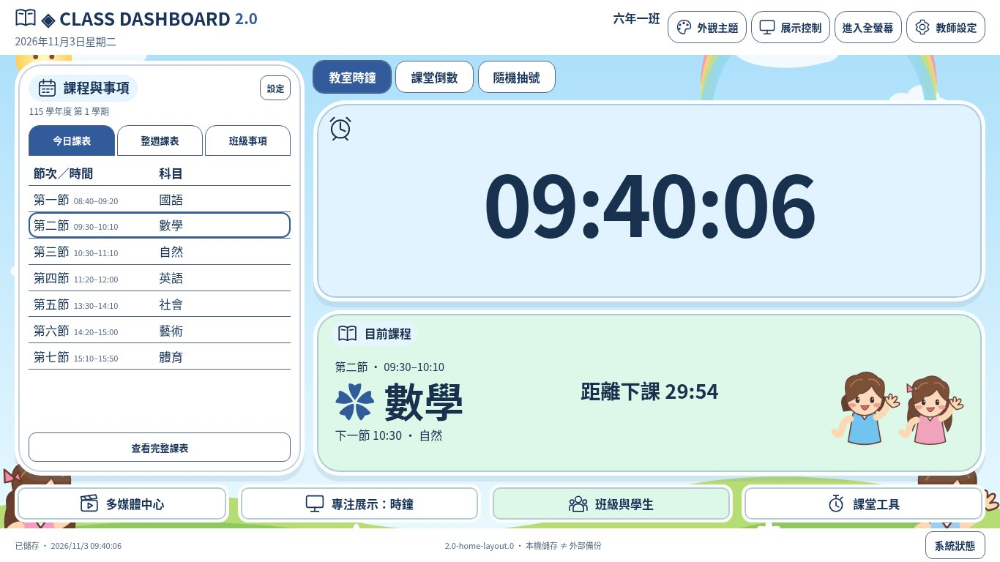
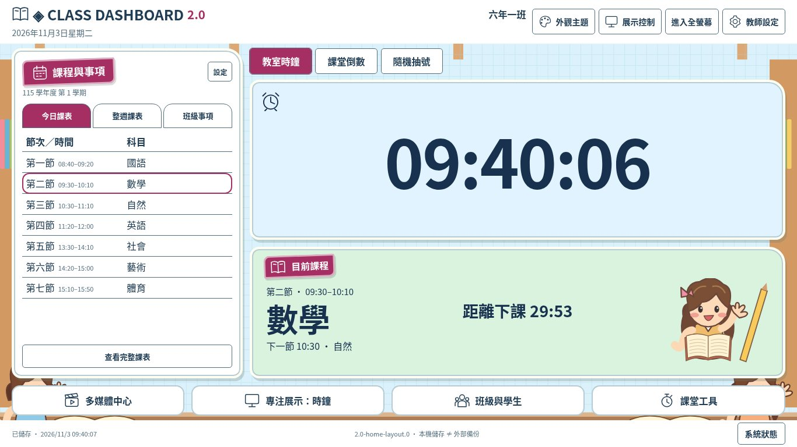
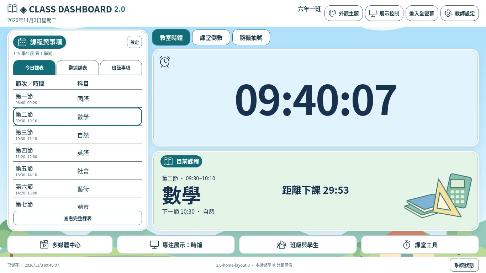
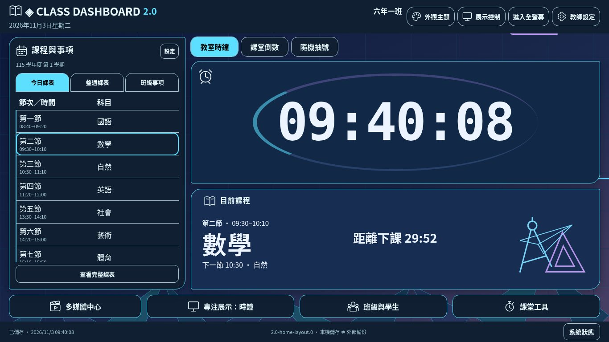
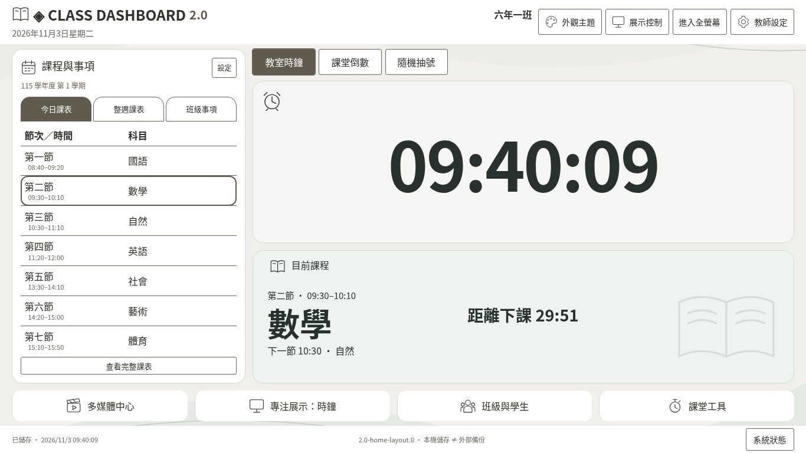
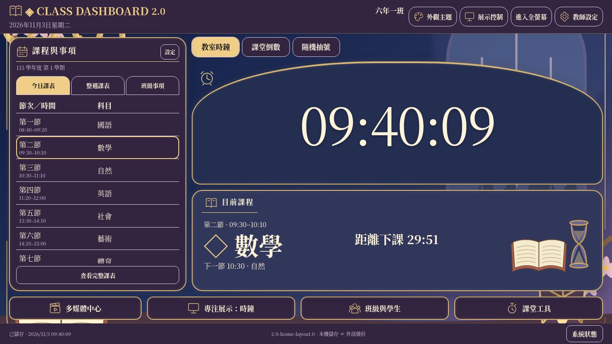

# 首頁左右展示布局｜開發測試報告

版本 **2.0-home-layout.0**，schemaVersion **7**。基準 main **737a5df**（已合併 PR #9），開發分支 `develop/class-dashboard-v2-home-layout`。只修改 `class-dashboard-v2/`，沒有合併、修改 Pages 來源或發布正式站。

本次依新布局指令，取代六風格各自擺放全部工具卡片的首頁。視覺素材與配色仍沿用 PR #9，共用同一套功能核心，不是重做六份網站。

## 原首頁與新首頁

| 區域 | 原首頁 | 新首頁 |
| --- | --- | --- |
| 頂部 | 系統列與既有顯示入口 | 精簡系統列，集中班級、日期、外觀、展示、全螢幕及設定 |
| 左側 | 課表區與獨立聯絡簿卡片 | 三頁籤：今日／整週／班級事項；完整檢視及編輯保留 |
| 中央 | 時鐘、課程、計時及抽號各占空間 | 三展示頁籤，時鐘與課程同畫面，大型倒數及大型抽號 |
| 聯絡簿 | 摘要卡、課程事項頁籤、底部入口重複 | 只留左側班級事項；資料、完成狀態、完整內容、編輯不變 |
| 底部 | 大型快捷卡片 | 多媒體、目前內容專注展示、班級學生、課堂工具四入口 |
| 計時提示 | 倒數卡常駐 | 切其他中央頁籤仍顯示進行／暫停／時間到與剩餘時間，可點擊返回 |

桌面標準左右約 30／70；原時鐘優先偏好稍縮左區、課表優先略加寬左區。手機／低於 960 寬或 620 高改用可捲動閱讀，不裁切控制。左側課表、完整內容及管理視窗必要時內部捲動，不以隱藏整頁溢出冒充單屏。

## 實際瀏覽器截圖

Linux Chromium 真實 DOM 截圖，使用合成班級／課表資料。90 張：18 配色 × 3 尺寸的時鐘畫面，加 6 風格預設配色 × 3 尺寸 × 2 個其他中央模式。原始量測：[home-layout-geometry.json](home-layout-geometry.json)。沒有把設計圖當網站背景。

### A 低年級童趣

[上一版畫面](screenshots/visual/playful-candy-1366x768.jpg)

| 中央模式 | 1920×1080 | 1366×768 | 1024×768 |
| --- | --- | --- | --- |
| 教室時鐘 | [實際截圖](screenshots/home-layout/playful-candy-clock-1920x1080.jpg) | [實際截圖](screenshots/home-layout/playful-candy-clock-1366x768.jpg) | [實際截圖](screenshots/home-layout/playful-candy-clock-1024x768.jpg) |
| 課堂倒數 | [實際截圖](screenshots/home-layout/playful-candy-timer-1920x1080.jpg) | [實際截圖](screenshots/home-layout/playful-candy-timer-1366x768.jpg) | [實際截圖](screenshots/home-layout/playful-candy-timer-1024x768.jpg) |
| 隨機抽號 | [實際截圖](screenshots/home-layout/playful-candy-picker-1920x1080.jpg) | [實際截圖](screenshots/home-layout/playful-candy-picker-1366x768.jpg) | [實際截圖](screenshots/home-layout/playful-candy-picker-1024x768.jpg) |
### B 中年級活潑

[上一版畫面](screenshots/visual/study-sun-1366x768.jpg)

| 中央模式 | 1920×1080 | 1366×768 | 1024×768 |
| --- | --- | --- | --- |
| 教室時鐘 | [實際截圖](screenshots/home-layout/study-sun-clock-1920x1080.jpg) | [實際截圖](screenshots/home-layout/study-sun-clock-1366x768.jpg) | [實際截圖](screenshots/home-layout/study-sun-clock-1024x768.jpg) |
| 課堂倒數 | [實際截圖](screenshots/home-layout/study-sun-timer-1920x1080.jpg) | [實際截圖](screenshots/home-layout/study-sun-timer-1366x768.jpg) | [實際截圖](screenshots/home-layout/study-sun-timer-1024x768.jpg) |
| 隨機抽號 | [實際截圖](screenshots/home-layout/study-sun-picker-1920x1080.jpg) | [實際截圖](screenshots/home-layout/study-sun-picker-1366x768.jpg) | [實際截圖](screenshots/home-layout/study-sun-picker-1024x768.jpg) |
### C 高年級清新

[上一版畫面](screenshots/visual/fresh-sky-1366x768.jpg)

| 中央模式 | 1920×1080 | 1366×768 | 1024×768 |
| --- | --- | --- | --- |
| 教室時鐘 | [實際截圖](screenshots/home-layout/fresh-sky-clock-1920x1080.jpg) | [實際截圖](screenshots/home-layout/fresh-sky-clock-1366x768.jpg) | [實際截圖](screenshots/home-layout/fresh-sky-clock-1024x768.jpg) |
| 課堂倒數 | [實際截圖](screenshots/home-layout/fresh-sky-timer-1920x1080.jpg) | [實際截圖](screenshots/home-layout/fresh-sky-timer-1366x768.jpg) | [實際截圖](screenshots/home-layout/fresh-sky-timer-1024x768.jpg) |
| 隨機抽號 | [實際截圖](screenshots/home-layout/fresh-sky-picker-1920x1080.jpg) | [實際截圖](screenshots/home-layout/fresh-sky-picker-1366x768.jpg) | [實際截圖](screenshots/home-layout/fresh-sky-picker-1024x768.jpg) |
### D 青少年科技

[上一版畫面](screenshots/visual/tech-electric-1366x768.jpg)

| 中央模式 | 1920×1080 | 1366×768 | 1024×768 |
| --- | --- | --- | --- |
| 教室時鐘 | [實際截圖](screenshots/home-layout/tech-electric-clock-1920x1080.jpg) | [實際截圖](screenshots/home-layout/tech-electric-clock-1366x768.jpg) | [實際截圖](screenshots/home-layout/tech-electric-clock-1024x768.jpg) |
| 課堂倒數 | [實際截圖](screenshots/home-layout/tech-electric-timer-1920x1080.jpg) | [實際截圖](screenshots/home-layout/tech-electric-timer-1366x768.jpg) | [實際截圖](screenshots/home-layout/tech-electric-timer-1024x768.jpg) |
| 隨機抽號 | [實際截圖](screenshots/home-layout/tech-electric-picker-1920x1080.jpg) | [實際截圖](screenshots/home-layout/tech-electric-picker-1366x768.jpg) | [實際截圖](screenshots/home-layout/tech-electric-picker-1024x768.jpg) |
### E 極簡專業

[上一版畫面](screenshots/visual/minimal-warm-1366x768.jpg)

| 中央模式 | 1920×1080 | 1366×768 | 1024×768 |
| --- | --- | --- | --- |
| 教室時鐘 | [實際截圖](screenshots/home-layout/minimal-warm-clock-1920x1080.jpg) | [實際截圖](screenshots/home-layout/minimal-warm-clock-1366x768.jpg) | [實際截圖](screenshots/home-layout/minimal-warm-clock-1024x768.jpg) |
| 課堂倒數 | [實際截圖](screenshots/home-layout/minimal-warm-timer-1920x1080.jpg) | [實際截圖](screenshots/home-layout/minimal-warm-timer-1366x768.jpg) | [實際截圖](screenshots/home-layout/minimal-warm-timer-1024x768.jpg) |
| 隨機抽號 | [實際截圖](screenshots/home-layout/minimal-warm-picker-1920x1080.jpg) | [實際截圖](screenshots/home-layout/minimal-warm-picker-1366x768.jpg) | [實際截圖](screenshots/home-layout/minimal-warm-picker-1024x768.jpg) |
### F 華麗展示

[上一版畫面](screenshots/visual/elegant-royal-purple-1366x768.jpg)

| 中央模式 | 1920×1080 | 1366×768 | 1024×768 |
| --- | --- | --- | --- |
| 教室時鐘 | [實際截圖](screenshots/home-layout/elegant-royal-purple-clock-1920x1080.jpg) | [實際截圖](screenshots/home-layout/elegant-royal-purple-clock-1366x768.jpg) | [實際截圖](screenshots/home-layout/elegant-royal-purple-clock-1024x768.jpg) |
| 課堂倒數 | [實際截圖](screenshots/home-layout/elegant-royal-purple-timer-1920x1080.jpg) | [實際截圖](screenshots/home-layout/elegant-royal-purple-timer-1366x768.jpg) | [實際截圖](screenshots/home-layout/elegant-royal-purple-timer-1024x768.jpg) |
| 隨機抽號 | [實際截圖](screenshots/home-layout/elegant-royal-purple-picker-1920x1080.jpg) | [實際截圖](screenshots/home-layout/elegant-royal-purple-picker-1366x768.jpg) | [實際截圖](screenshots/home-layout/elegant-royal-purple-picker-1024x768.jpg) |

## 全部 18 配色截圖

| 風格／配色 | 1920×1080 | 1366×768 | 1024×768 |
| --- | --- | --- | --- |
| playful/candy | [實際截圖](screenshots/home-layout/playful-candy-clock-1920x1080.jpg) | [實際截圖](screenshots/home-layout/playful-candy-clock-1366x768.jpg) | [實際截圖](screenshots/home-layout/playful-candy-clock-1024x768.jpg) |
| playful/ocean | [實際截圖](screenshots/home-layout/playful-ocean-clock-1920x1080.jpg) | [實際截圖](screenshots/home-layout/playful-ocean-clock-1366x768.jpg) | [實際截圖](screenshots/home-layout/playful-ocean-clock-1024x768.jpg) |
| playful/forest | [實際截圖](screenshots/home-layout/playful-forest-clock-1920x1080.jpg) | [實際截圖](screenshots/home-layout/playful-forest-clock-1366x768.jpg) | [實際截圖](screenshots/home-layout/playful-forest-clock-1024x768.jpg) |
| study/sun | [實際截圖](screenshots/home-layout/study-sun-clock-1920x1080.jpg) | [實際截圖](screenshots/home-layout/study-sun-clock-1366x768.jpg) | [實際截圖](screenshots/home-layout/study-sun-clock-1024x768.jpg) |
| study/mint | [實際截圖](screenshots/home-layout/study-mint-clock-1920x1080.jpg) | [實際截圖](screenshots/home-layout/study-mint-clock-1366x768.jpg) | [實際截圖](screenshots/home-layout/study-mint-clock-1024x768.jpg) |
| study/berry | [實際截圖](screenshots/home-layout/study-berry-clock-1920x1080.jpg) | [實際截圖](screenshots/home-layout/study-berry-clock-1366x768.jpg) | [實際截圖](screenshots/home-layout/study-berry-clock-1024x768.jpg) |
| fresh/sky | [實際截圖](screenshots/home-layout/fresh-sky-clock-1920x1080.jpg) | [實際截圖](screenshots/home-layout/fresh-sky-clock-1366x768.jpg) | [實際截圖](screenshots/home-layout/fresh-sky-clock-1024x768.jpg) |
| fresh/cream | [實際截圖](screenshots/home-layout/fresh-cream-clock-1920x1080.jpg) | [實際截圖](screenshots/home-layout/fresh-cream-clock-1366x768.jpg) | [實際截圖](screenshots/home-layout/fresh-cream-clock-1024x768.jpg) |
| fresh/sage | [實際截圖](screenshots/home-layout/fresh-sage-clock-1920x1080.jpg) | [實際截圖](screenshots/home-layout/fresh-sage-clock-1366x768.jpg) | [實際截圖](screenshots/home-layout/fresh-sage-clock-1024x768.jpg) |
| tech/electric | [實際截圖](screenshots/home-layout/tech-electric-clock-1920x1080.jpg) | [實際截圖](screenshots/home-layout/tech-electric-clock-1366x768.jpg) | [實際截圖](screenshots/home-layout/tech-electric-clock-1024x768.jpg) |
| tech/cyber | [實際截圖](screenshots/home-layout/tech-cyber-clock-1920x1080.jpg) | [實際截圖](screenshots/home-layout/tech-cyber-clock-1366x768.jpg) | [實際截圖](screenshots/home-layout/tech-cyber-clock-1024x768.jpg) |
| tech/aurora | [實際截圖](screenshots/home-layout/tech-aurora-clock-1920x1080.jpg) | [實際截圖](screenshots/home-layout/tech-aurora-clock-1366x768.jpg) | [實際截圖](screenshots/home-layout/tech-aurora-clock-1024x768.jpg) |
| minimal/warm | [實際截圖](screenshots/home-layout/minimal-warm-clock-1920x1080.jpg) | [實際截圖](screenshots/home-layout/minimal-warm-clock-1366x768.jpg) | [實際截圖](screenshots/home-layout/minimal-warm-clock-1024x768.jpg) |
| minimal/cool | [實際截圖](screenshots/home-layout/minimal-cool-clock-1920x1080.jpg) | [實際截圖](screenshots/home-layout/minimal-cool-clock-1366x768.jpg) | [實際截圖](screenshots/home-layout/minimal-cool-clock-1024x768.jpg) |
| minimal/graphite | [實際截圖](screenshots/home-layout/minimal-graphite-clock-1920x1080.jpg) | [實際截圖](screenshots/home-layout/minimal-graphite-clock-1366x768.jpg) | [實際截圖](screenshots/home-layout/minimal-graphite-clock-1024x768.jpg) |
| elegant/royal-purple | [實際截圖](screenshots/home-layout/elegant-royal-purple-clock-1920x1080.jpg) | [實際截圖](screenshots/home-layout/elegant-royal-purple-clock-1366x768.jpg) | [實際截圖](screenshots/home-layout/elegant-royal-purple-clock-1024x768.jpg) |
| elegant/royal-blue | [實際截圖](screenshots/home-layout/elegant-royal-blue-clock-1920x1080.jpg) | [實際截圖](screenshots/home-layout/elegant-royal-blue-clock-1366x768.jpg) | [實際截圖](screenshots/home-layout/elegant-royal-blue-clock-1024x768.jpg) |
| elegant/sakura | [實際截圖](screenshots/home-layout/elegant-sakura-clock-1920x1080.jpg) | [實際截圖](screenshots/home-layout/elegant-sakura-clock-1366x768.jpg) | [實際截圖](screenshots/home-layout/elegant-sakura-clock-1024x768.jpg) |

## 資料及生命週期

- 沿用集中 store、驗證、寫入成功後更新、Web Locks 及過期分頁保護。schema 7 不變，沒有新遷移或初始化重設。學生 ID、作息、學期、課表、單日調課、聯絡簿、抽號、影音清單、顯示及歷史任務保留。
- 中央頁籤是暫時 UI 狀態；重新整理回時鐘，原計時與抽號狀態照常恢復。沒有第二份計時器、抽號或影音權威。
- 執行中提示直接觀察既有計時 output／store，不新增 setInterval。中央切頁不重建 DOM、播放器、資料訂閱或時鐘。
- 「專注展示」沿用既有 focus 命令；四種專注、全螢幕與投影隱私仍使用原核心。main 本來未有 I-C 新卡片聚焦／新提示音種類試聽，這次不冒稱補完，保留現有完整內容子畫面及四種專注能力。
- 原創素材仍保留六風格差異（人物紙張／校園／科技儀表／極簡／拱窗金框等）；本次依新指令統一主布局，不再要求六種不同功能位置。

## 自動化測試

[指令結果摘要](home-layout-test-results.txt)。執行前由 repository 根目錄啟動 HTTP，測試 URL 指向 `/class-dashboard-v2/`；測試採 Linux Chromium、Playwright。本次使用 localhost:8011。

| 項目 | 方法 | 預期與實際結果 | 狀態 | 嚴重度／建議 |
| --- | --- | --- | --- | --- |
| 資料及核心回歸 | npm test | 82 項通過，0 失敗；含版本相容、資料不變、驗證、儲存失敗、過期分頁、鎖及備份 | 通過 | 無新增資料模型 |
| 中央／左側頁籤及版面 | npm run test:browser | 18 配色 × 5 尺寸 × 3 模式＝270 組，無頁面／按鈕／卡片溢出 | 通過 | 五尺寸含 1600×900、1280×720 |
| 字級及布局偏好 | 同上 | 六風格 × 2 尺寸 × 4 字級 × 3 模式＝144 組；三種布局可操作；最大 1440:00 倒數於特大字有界顯示 | 通過 | 特殊長文字以可讀降級優先 |
| 聯絡簿整合 | 真實點擊三頁籤、完整／編輯 | 無重複卡片或下方聯絡簿入口；原資料與完成狀態不變 | 通過 | 保留摘要，不刪事項 |
| 倒數／抽號／影音 | 真實點擊、實際 WAV 播放 | 暫停、繼續、跨頁籤提示與 deadline；抽號結果穩定；同一背景音樂實例不中斷 | 通過 | 沒有新播放器核心 |
| 專注／全螢幕／鍵盤／隱私 | Chromium 原生及頁面操作 | 四種專注正常、全螢幕進出、左右鍵選頁籤、隱私停用學生入口 | 通過 | 不等同 Windows 觸控實機 |
| JSON 與教師設定 | 下載、無效檔、預覽確認還原 | schema7，無效檔不覆蓋，完整還原成功；學生、課表、歷史不變 | 通過 | 非遠端同步 |
| 截圖檢查 | npm run capture:home | 90 張，執行錯誤 0、幾何失敗 0 | 通過 | 詳見截圖與量測 JSON |
| Pages 相對資源 | 本機 HTTP 版本清單比對 | 71 項資源路徑及 SHA-256 一致 | 通過 | 不是正式站已部署證據 |
| 正式站／原版參考站／GitHub API | HTTP／API | CONNECT 403／Forbidden，無法核實當前正式部署 | 未驗證 | 沒有修改正式站 |
| Windows11 Chrome／Edge／白板／喇叭／外部 YouTube 實播 | 缺少對應實機或第三方存取 | 不宣稱通過 | 未驗證 | 依操作指南人工驗收 |

開發中發現並修正：舊專注 CSS 將課表專注隱藏、測試在非同步抽號保存前讀取舊紀錄、頂部與緊湊尺寸的版面整合。修正後重新測試及截圖。

既有 Stage3～4D 與舊 I-B 的瀏覽器腳本保留供舊提交回歸，但它們預設所有工具卡片同時可點，不符合新頁籤介面。因此本次 `test:browser` 使用新布局操作流程，舊完整 UI 套件保留為 `test:browser:previous-layout`，**沒有宣稱舊版全部 UI 腳本在本次也重跑通過**。核心 Node 測試持續全跑。

## 修改檔案

- index.html：左側三頁籤、中央三展示面板、唯一權威 DOM、精簡上下工具列與日期位置。
- styles/home-layout.css：新的共用左右布局、中央大字、響應式、字級／布局／專注整合，沿用原 visual.css 的素材與配色。
- src/ui/stage.js：暫時頁籤、鍵盤、倒數提示、既有專注入口；src/ui/visual.js 移除重複事項及科技導航事件，保留安全入口與原創圖示。
- src/app.js：只掛載一次新 UI；src/ui/backup.js：版本顯示。
- tests/home-layout-browser.cjs、tests/version.test.js、tests/visual.test.js、tools/capture-home-layout.cjs、tools/release.mjs、package.json、version.json。
- README、Windows11／Pages 說明、本報告、量測 JSON、90 張審查截圖。其餘 ES module diff 主要是統一快取查詢版本更新，資料 reducer 未改。

## Windows11 驗收

[操作指南](windows11-guide.md)。先備份 → 左側三頁籤與完整／編輯 → 中央三頁籤 → 倒數執行切回時鐘確認提示、返回暫停繼續 → 抽號切頁不重置 → 播音樂切頁不中斷 → 四種專注與原生全螢幕 → 隱私與學生設定 → JSON 下載／預覽／確認還原。逐一試三個指定解析度及六風格三配色。

寬不足 960、高不足 620 或超長必要文字／高縮放時，可降級捲動閱讀；完整課表、管理及影音視窗可內部捲動。單日調課與固定課表模型未改。第三方平台政策、實機音效、不同 Windows 字型仍需人工驗收。

## GitHub／獨立驗收狀態

main 開工基準是 737a5df，本次未合併或部署。GitHub API 目前 Forbidden，推送及 PR 建立嘗試結果見交付訊息。此報告屬開發自測，獨立整合檢查須由使用者提供 PR 後另行啟動；不是自動背景審查或正式上線核准。
