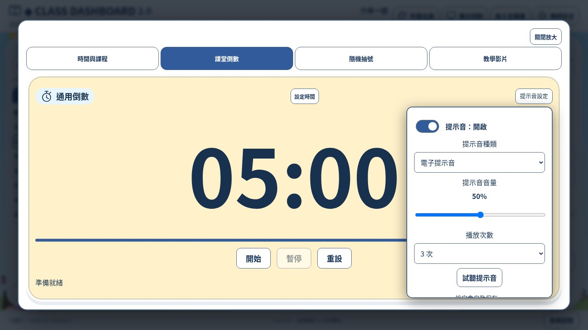
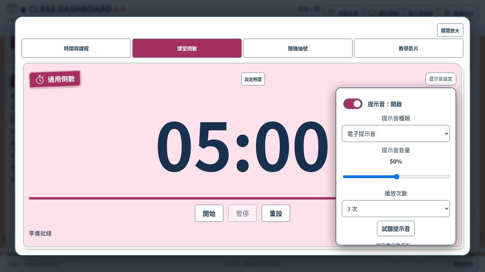
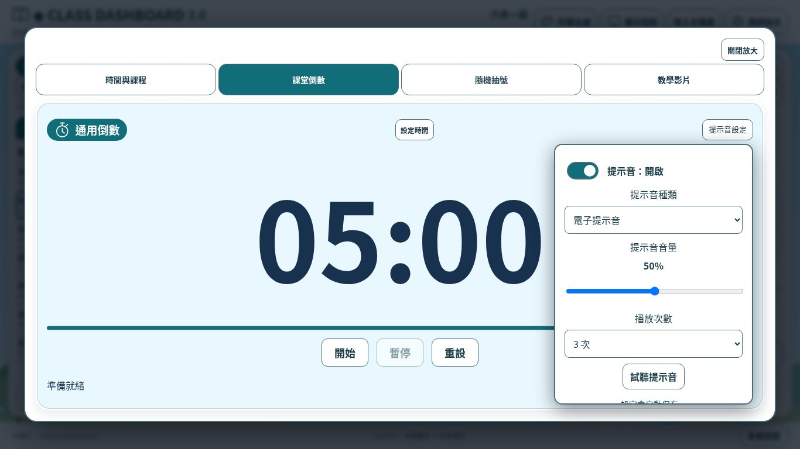
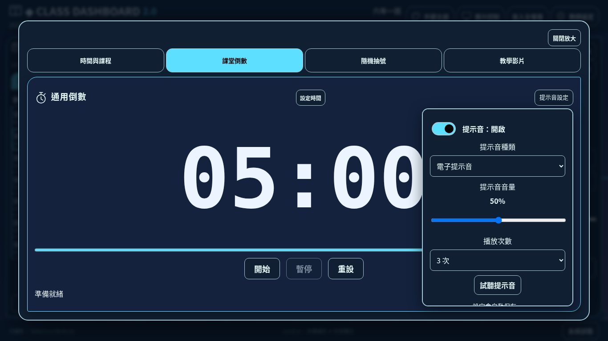
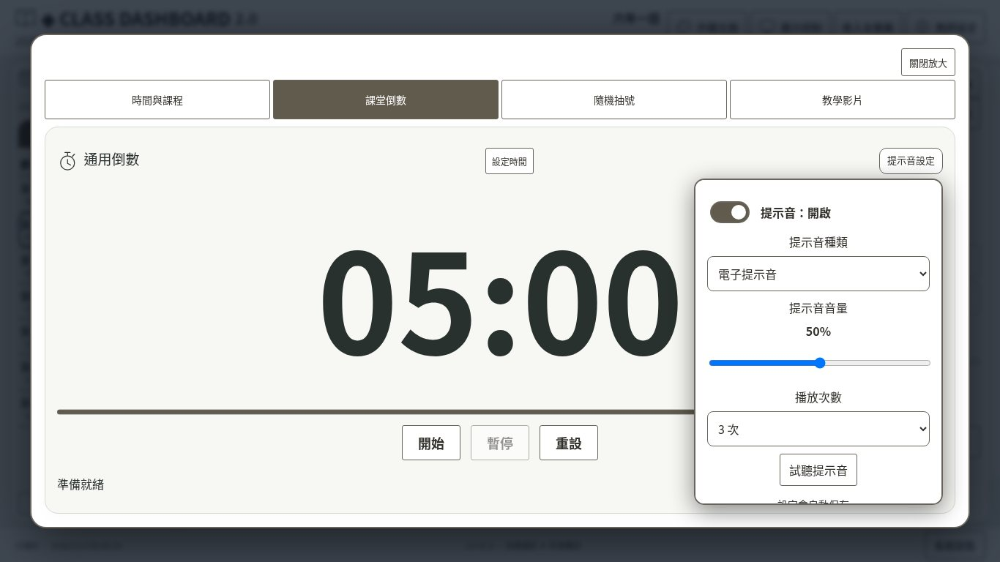
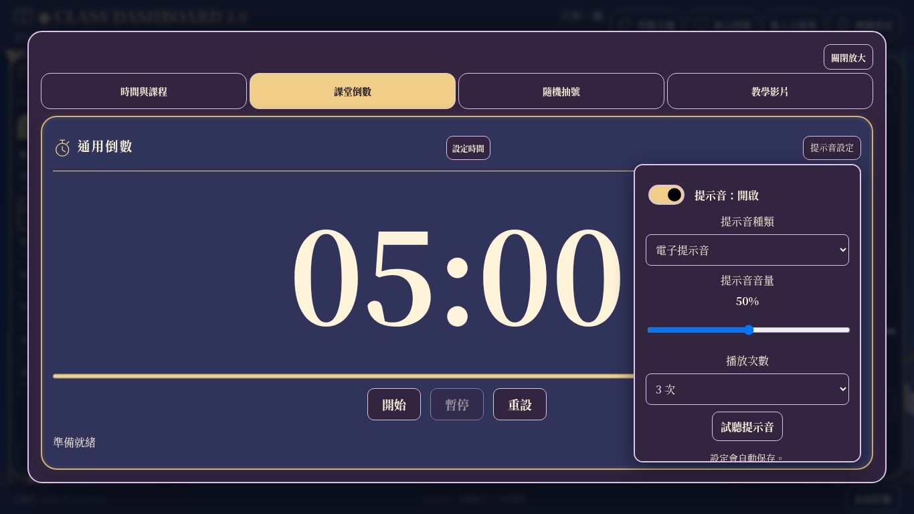

# I-C功能補強｜開發自測與交付

版本 **2.0-IC.0**，schemaVersion **8**，JSON formatVersion **1**。基準main **820ed7a**（已合併PR #11），分支 `develop/class-dashboard-v2-ic-completion`。只改指定專案目錄；未合併、修改Pages或部署。

本次只補提示音及通用聚焦，不重設三欄布局、不恢復任務／水族箱、不執行I-D完整獨立驗收。

## 已完成

| 提示音 | 通用聚焦 |
| --- | --- |
| 明確開關、三音效、1／2／3次、音量百分比與0靜音、試聽 | 左側課程事項、中央時鐘／倒數／抽號、右側工具可放大 |
| 教師與倒數共用設定；成功保存才更新，失敗回復 | 原DOM進原生模態上層，背景淡化、不可誤操作 |
| 一個WebAudio引擎，快速試聽取消前次排程 | 關閉／Esc返回，Tab／Shift+Tab留在視窗，觸控入口 |
| 試聽不改計時、開關或媒體音量 | 不複製計時、抽號、資料或播放器，不搬動媒體 |
| 結束先保存，音訊失敗仍有時間到文字 | 舊專注／影片放大重用，管理視窗協調單一模態 |

電子音784Hz、0.16秒、每組間隔0.3秒，預設三組延續舊節奏；鐘聲採523.25／1046.5Hz衰減疊音；清脆鈴採880／1320／1760Hz不同波形與錯開衰減。全部原創合成，沒有下載音樂檔、外部音效服務或授權不明素材。播放次數是訊號組數，不把和聲分音當成多次。

## 資料相容

7→8僅新增preferences.timerSoundType（electronic／bell／ring）、timerSoundCount（1／2／3），預設electronic及3，原timerSound布林與volume保留。學生固定ID、姓名座號、作息、課表、事項、抽號、媒體庫、顯示及歷史完整。

讀取舊資料只在記憶體遷移，不立即寫回；首次成功操作才保存8。驗證不合法音效／次數與壞備份，失敗不覆蓋。沿用集中store、Web Locks、revision／過期頁及原始資料保護。JSON格式仍1，備份還原包含新欄位。舊版歷史測試更新為明確新增預設的預期，沒有移除ID／歷史／寫入失敗檢查。

升級前備份及關閉舊分頁；舊schema7程式拒絕schema8，不可直接降版或只改版本號。測試使用本機獨立來源，沒有寫入正式站資料。

## 實際截圖

90張Linux Chromium截圖，合成班級／課表資料。54張為18配色×3尺寸的倒數聚焦＋提示音面板；18張是6風格×3尺寸首頁；另18張是6風格1366×768的時鐘／事項／工具聚焦。

[幾何資料](ic-geometry.json) · [指令結果](ic-test-results.txt)

### A 低年級童趣

| 畫面 | 1920×1080 | 1366×768 | 1024×768 |
| --- | --- | --- | --- |
| 原三欄首頁 | [截圖](screenshots/ic/playful-candy-home-1920x1080.jpg) | [截圖](screenshots/ic/playful-candy-home-1366x768.jpg) | [截圖](screenshots/ic/playful-candy-home-1024x768.jpg) |
| 倒數聚焦＋提示音 | [截圖](screenshots/ic/playful-candy-timer-focus-sound-1920x1080.jpg) | [截圖](screenshots/ic/playful-candy-timer-focus-sound-1366x768.jpg) | [截圖](screenshots/ic/playful-candy-timer-focus-sound-1024x768.jpg) |

其他聚焦：[時鐘](screenshots/ic/playful-candy-clock-focus-1366x768.jpg) · [班級事項](screenshots/ic/playful-candy-notes-focus-1366x768.jpg) · [工具](screenshots/ic/playful-candy-widget-focus-1366x768.jpg)

### B 中年級活潑

| 畫面 | 1920×1080 | 1366×768 | 1024×768 |
| --- | --- | --- | --- |
| 原三欄首頁 | [截圖](screenshots/ic/study-sun-home-1920x1080.jpg) | [截圖](screenshots/ic/study-sun-home-1366x768.jpg) | [截圖](screenshots/ic/study-sun-home-1024x768.jpg) |
| 倒數聚焦＋提示音 | [截圖](screenshots/ic/study-sun-timer-focus-sound-1920x1080.jpg) | [截圖](screenshots/ic/study-sun-timer-focus-sound-1366x768.jpg) | [截圖](screenshots/ic/study-sun-timer-focus-sound-1024x768.jpg) |

其他聚焦：[時鐘](screenshots/ic/study-sun-clock-focus-1366x768.jpg) · [班級事項](screenshots/ic/study-sun-notes-focus-1366x768.jpg) · [工具](screenshots/ic/study-sun-widget-focus-1366x768.jpg)

### C 高年級清新

| 畫面 | 1920×1080 | 1366×768 | 1024×768 |
| --- | --- | --- | --- |
| 原三欄首頁 | [截圖](screenshots/ic/fresh-sky-home-1920x1080.jpg) | [截圖](screenshots/ic/fresh-sky-home-1366x768.jpg) | [截圖](screenshots/ic/fresh-sky-home-1024x768.jpg) |
| 倒數聚焦＋提示音 | [截圖](screenshots/ic/fresh-sky-timer-focus-sound-1920x1080.jpg) | [截圖](screenshots/ic/fresh-sky-timer-focus-sound-1366x768.jpg) | [截圖](screenshots/ic/fresh-sky-timer-focus-sound-1024x768.jpg) |

其他聚焦：[時鐘](screenshots/ic/fresh-sky-clock-focus-1366x768.jpg) · [班級事項](screenshots/ic/fresh-sky-notes-focus-1366x768.jpg) · [工具](screenshots/ic/fresh-sky-widget-focus-1366x768.jpg)

### D 青少年科技

| 畫面 | 1920×1080 | 1366×768 | 1024×768 |
| --- | --- | --- | --- |
| 原三欄首頁 | [截圖](screenshots/ic/tech-electric-home-1920x1080.jpg) | [截圖](screenshots/ic/tech-electric-home-1366x768.jpg) | [截圖](screenshots/ic/tech-electric-home-1024x768.jpg) |
| 倒數聚焦＋提示音 | [截圖](screenshots/ic/tech-electric-timer-focus-sound-1920x1080.jpg) | [截圖](screenshots/ic/tech-electric-timer-focus-sound-1366x768.jpg) | [截圖](screenshots/ic/tech-electric-timer-focus-sound-1024x768.jpg) |

其他聚焦：[時鐘](screenshots/ic/tech-electric-clock-focus-1366x768.jpg) · [班級事項](screenshots/ic/tech-electric-notes-focus-1366x768.jpg) · [工具](screenshots/ic/tech-electric-widget-focus-1366x768.jpg)

### E 極簡專業

| 畫面 | 1920×1080 | 1366×768 | 1024×768 |
| --- | --- | --- | --- |
| 原三欄首頁 | [截圖](screenshots/ic/minimal-warm-home-1920x1080.jpg) | [截圖](screenshots/ic/minimal-warm-home-1366x768.jpg) | [截圖](screenshots/ic/minimal-warm-home-1024x768.jpg) |
| 倒數聚焦＋提示音 | [截圖](screenshots/ic/minimal-warm-timer-focus-sound-1920x1080.jpg) | [截圖](screenshots/ic/minimal-warm-timer-focus-sound-1366x768.jpg) | [截圖](screenshots/ic/minimal-warm-timer-focus-sound-1024x768.jpg) |

其他聚焦：[時鐘](screenshots/ic/minimal-warm-clock-focus-1366x768.jpg) · [班級事項](screenshots/ic/minimal-warm-notes-focus-1366x768.jpg) · [工具](screenshots/ic/minimal-warm-widget-focus-1366x768.jpg)

### F 華麗展示

| 畫面 | 1920×1080 | 1366×768 | 1024×768 |
| --- | --- | --- | --- |
| 原三欄首頁 | [截圖](screenshots/ic/elegant-royal-purple-home-1920x1080.jpg) | [截圖](screenshots/ic/elegant-royal-purple-home-1366x768.jpg) | [截圖](screenshots/ic/elegant-royal-purple-home-1024x768.jpg) |
| 倒數聚焦＋提示音 | [截圖](screenshots/ic/elegant-royal-purple-timer-focus-sound-1920x1080.jpg) | [截圖](screenshots/ic/elegant-royal-purple-timer-focus-sound-1366x768.jpg) | [截圖](screenshots/ic/elegant-royal-purple-timer-focus-sound-1024x768.jpg) |

其他聚焦：[時鐘](screenshots/ic/elegant-royal-purple-clock-focus-1366x768.jpg) · [班級事項](screenshots/ic/elegant-royal-purple-notes-focus-1366x768.jpg) · [工具](screenshots/ic/elegant-royal-purple-widget-focus-1366x768.jpg)

## 18配色提示音與聚焦

| 風格／配色 | 1920×1080 | 1366×768 | 1024×768 |
| --- | --- | --- | --- |
| playful/candy | [截圖](screenshots/ic/playful-candy-timer-focus-sound-1920x1080.jpg) | [截圖](screenshots/ic/playful-candy-timer-focus-sound-1366x768.jpg) | [截圖](screenshots/ic/playful-candy-timer-focus-sound-1024x768.jpg) |
| playful/ocean | [截圖](screenshots/ic/playful-ocean-timer-focus-sound-1920x1080.jpg) | [截圖](screenshots/ic/playful-ocean-timer-focus-sound-1366x768.jpg) | [截圖](screenshots/ic/playful-ocean-timer-focus-sound-1024x768.jpg) |
| playful/forest | [截圖](screenshots/ic/playful-forest-timer-focus-sound-1920x1080.jpg) | [截圖](screenshots/ic/playful-forest-timer-focus-sound-1366x768.jpg) | [截圖](screenshots/ic/playful-forest-timer-focus-sound-1024x768.jpg) |
| study/sun | [截圖](screenshots/ic/study-sun-timer-focus-sound-1920x1080.jpg) | [截圖](screenshots/ic/study-sun-timer-focus-sound-1366x768.jpg) | [截圖](screenshots/ic/study-sun-timer-focus-sound-1024x768.jpg) |
| study/mint | [截圖](screenshots/ic/study-mint-timer-focus-sound-1920x1080.jpg) | [截圖](screenshots/ic/study-mint-timer-focus-sound-1366x768.jpg) | [截圖](screenshots/ic/study-mint-timer-focus-sound-1024x768.jpg) |
| study/berry | [截圖](screenshots/ic/study-berry-timer-focus-sound-1920x1080.jpg) | [截圖](screenshots/ic/study-berry-timer-focus-sound-1366x768.jpg) | [截圖](screenshots/ic/study-berry-timer-focus-sound-1024x768.jpg) |
| fresh/sky | [截圖](screenshots/ic/fresh-sky-timer-focus-sound-1920x1080.jpg) | [截圖](screenshots/ic/fresh-sky-timer-focus-sound-1366x768.jpg) | [截圖](screenshots/ic/fresh-sky-timer-focus-sound-1024x768.jpg) |
| fresh/cream | [截圖](screenshots/ic/fresh-cream-timer-focus-sound-1920x1080.jpg) | [截圖](screenshots/ic/fresh-cream-timer-focus-sound-1366x768.jpg) | [截圖](screenshots/ic/fresh-cream-timer-focus-sound-1024x768.jpg) |
| fresh/sage | [截圖](screenshots/ic/fresh-sage-timer-focus-sound-1920x1080.jpg) | [截圖](screenshots/ic/fresh-sage-timer-focus-sound-1366x768.jpg) | [截圖](screenshots/ic/fresh-sage-timer-focus-sound-1024x768.jpg) |
| tech/electric | [截圖](screenshots/ic/tech-electric-timer-focus-sound-1920x1080.jpg) | [截圖](screenshots/ic/tech-electric-timer-focus-sound-1366x768.jpg) | [截圖](screenshots/ic/tech-electric-timer-focus-sound-1024x768.jpg) |
| tech/cyber | [截圖](screenshots/ic/tech-cyber-timer-focus-sound-1920x1080.jpg) | [截圖](screenshots/ic/tech-cyber-timer-focus-sound-1366x768.jpg) | [截圖](screenshots/ic/tech-cyber-timer-focus-sound-1024x768.jpg) |
| tech/aurora | [截圖](screenshots/ic/tech-aurora-timer-focus-sound-1920x1080.jpg) | [截圖](screenshots/ic/tech-aurora-timer-focus-sound-1366x768.jpg) | [截圖](screenshots/ic/tech-aurora-timer-focus-sound-1024x768.jpg) |
| minimal/warm | [截圖](screenshots/ic/minimal-warm-timer-focus-sound-1920x1080.jpg) | [截圖](screenshots/ic/minimal-warm-timer-focus-sound-1366x768.jpg) | [截圖](screenshots/ic/minimal-warm-timer-focus-sound-1024x768.jpg) |
| minimal/cool | [截圖](screenshots/ic/minimal-cool-timer-focus-sound-1920x1080.jpg) | [截圖](screenshots/ic/minimal-cool-timer-focus-sound-1366x768.jpg) | [截圖](screenshots/ic/minimal-cool-timer-focus-sound-1024x768.jpg) |
| minimal/graphite | [截圖](screenshots/ic/minimal-graphite-timer-focus-sound-1920x1080.jpg) | [截圖](screenshots/ic/minimal-graphite-timer-focus-sound-1366x768.jpg) | [截圖](screenshots/ic/minimal-graphite-timer-focus-sound-1024x768.jpg) |
| elegant/royal-purple | [截圖](screenshots/ic/elegant-royal-purple-timer-focus-sound-1920x1080.jpg) | [截圖](screenshots/ic/elegant-royal-purple-timer-focus-sound-1366x768.jpg) | [截圖](screenshots/ic/elegant-royal-purple-timer-focus-sound-1024x768.jpg) |
| elegant/royal-blue | [截圖](screenshots/ic/elegant-royal-blue-timer-focus-sound-1920x1080.jpg) | [截圖](screenshots/ic/elegant-royal-blue-timer-focus-sound-1366x768.jpg) | [截圖](screenshots/ic/elegant-royal-blue-timer-focus-sound-1024x768.jpg) |
| elegant/sakura | [截圖](screenshots/ic/elegant-sakura-timer-focus-sound-1920x1080.jpg) | [截圖](screenshots/ic/elegant-sakura-timer-focus-sound-1366x768.jpg) | [截圖](screenshots/ic/elegant-sakura-timer-focus-sound-1024x768.jpg) |

## 測試紀錄（I-C開發自測）

| 項目 | 方法 | 結果 | 狀態／限制 |
| --- | --- | --- | --- |
| 現有核心及新增相容 | npm test | 90項，0失敗；含遷移、ID／歷史、JSON、驗證、Quota與過期頁、寫入鎖 | 通過 |
| 三欄回歸 | three-columns-browser | 360布局／中央頁籤組合、192字級案例、三布局、四專注、抽號、聯絡簿、隱私、全螢幕、備份 | 通過 |
| 影音回歸 | three-media-browser | 真實WAV／MP3／WebM、同一節點、互斥、切頁保留進度、原影片放大／Esc／fullscreen、計時連動 | 通過；YouTube API為替身 |
| 提示音種類／次數 | ic-browser＋純函式／假AudioContext | 九種音效×次數組合；停用可試聽、0不發聲、單Context、快速取消前次 | 模擬排程通過，非喇叭音色 |
| 自動完成與失敗 | 同上 | 正常完成只排程一次3組鈴聲；停用不發聲；音訊拒絕仍FINISHED及文字；刷新不重播 | 通過 |
| 保存與兩入口 | 真實UI／Quota模擬 | 兩處設定一致、百分比、失敗回復、刷新與JSON還原含新偏好 | 通過 |
| 不改背景影音 | 同上＋影音回歸 | 試聽期間真實WAV不中斷、媒體音量不變；原連動仍有效 | 通過 |
| 聚焦鍵盤／觸控 | 18配色×3尺寸×7情境 | 378組（中央3、左側3、右側1），modal界線／Tab／Esc／觸控、狀態不變、同節點 | 通過 |
| 原專注與管理協調 | 真實UI | 聚焦內切專注先關閉模態；原四專注及影片放大保持 | 通過 |
| 真實WebAudio API | ic-real-audio-browser（無AudioContext替身） | 三音色試聽可排程，無API錯誤 | 通過；不能證明實體出聲與聽感 |
| 截圖 | capture:ic | 90張、執行錯誤0、幾何失敗0 | 通過 |
| 相對路徑／雜湊 | 本機HTTP版本清單 | 77項HTML/CSS/JS/SVG | 通過，不等於正式部署 |
| Windows11、白板、實體喇叭、YouTube實播 | 無對應實機／平台存取 | 不宣稱驗收 | 未驗證 |

開發時修正原生Tab可能移到瀏覽器工具列的焦點循環、切原專注時不可留下隱形模態，以及寫入成功前的切換開關測試時序。原有三欄與媒體核心沿用，測試中的AudioContext及官方YouTube替身均明示，不冒稱實機。

## 實作與修改檔案

- src/school/sound-model.js、school/model.js／commands.js／validation.js、core/model.js／migrations.js：音效計畫、驗證及schema8。
- src/ui/sound.js：單一WebAudio排程／取消／錯誤結果；src/ui/sound-settings.js：兩入口共用、自動保存與失敗回復；src/ui/tools.js：先保存計時結果再音效，不讓音效失敗改寫計時結果。
- src/ui/card-focus.js、index.html、styles/ic.css：原生模態聚焦、鍵盤／返回、提示音面板；沒有clone或DOM reparent。src/ui/widgets.js重用影片放大前先協調通用聚焦。
- src/app.js：各控制只掛載一次並共用同一提示音引擎；src/ui/stage.js：切頁收合提示音面板；src/ui/backup.js：版本顯示。
- tests/ic.test.js、ic-browser.cjs、ic-real-audio-browser.cjs、sound-expectations.js、現有回歸測試相容預期；tools/capture-ic.cjs、release.mjs、package.json、version.json。
- README、Windows11／Pages指南、本報告、90張截圖與量測。其餘ES module多為統一快取版本查詢更新，沒有變更學生／課表／聯絡簿reducer。

## 已知限制及人工驗收

[Windows11操作步驟](windows11-guide.md)。請使用升級前JSON備份，在Chrome／Edge試三解析度與18配色；聆聽三音效辨識差異、調音量、1／2／3次、停用與0靜音。試聽不啟動計時、背景音樂與影片音量不變。計時1秒到時文字與音效，刷新不重播；保存失敗回復設定；下載／預覽／確認還原JSON。

放大時鐘、倒數、抽號、今日／整週／事項與工具；試觸控、Tab／Shift+Tab、Esc／關閉、返回原按鈕。先全螢幕再放大可組合使用。長內容允許視窗內部捲動，低於960寬／620高或高縮放維持可讀降級。原有影片專屬放大不新增第二套。

三音效是短促提示，不是可自訂音樂。音訊可能被瀏覽器／裝置靜音或政策阻擋；API成功不保證實體喇叭聽感。YouTube限制及Windows字型、白板觸控須實機驗證。此處不是I-D獨立完整驗收，後續由使用者提供PR後另行啟動。

## GitHub與發布

本次不合併main或部署，正式網址不變。API若仍Forbidden，交付只提供已推送分支及建立PR入口，不假稱PR建立成功。實際提交／推送／PR狀態見交付訊息。
