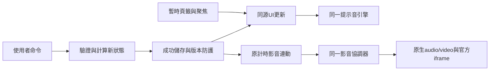
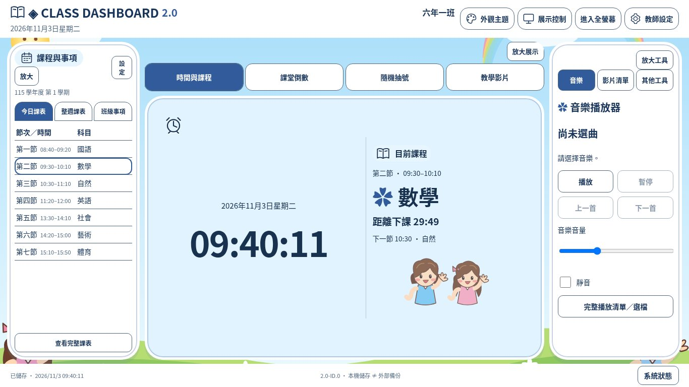
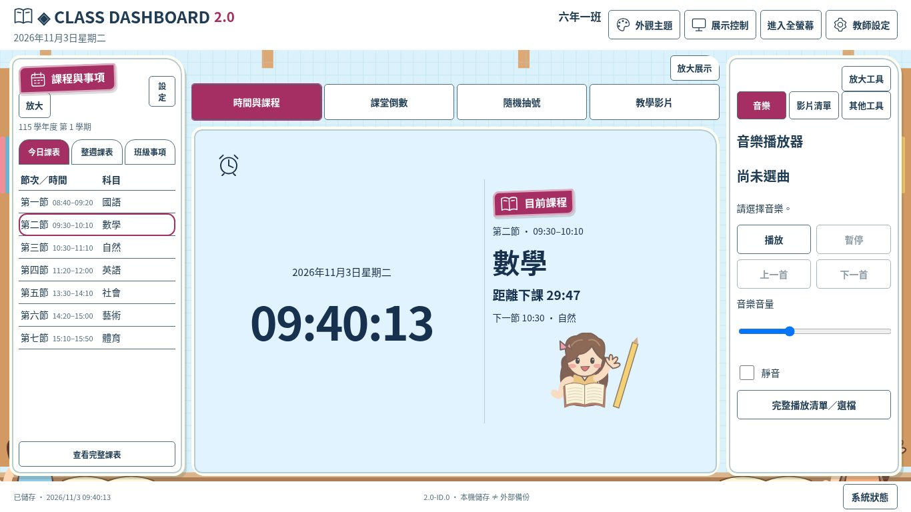
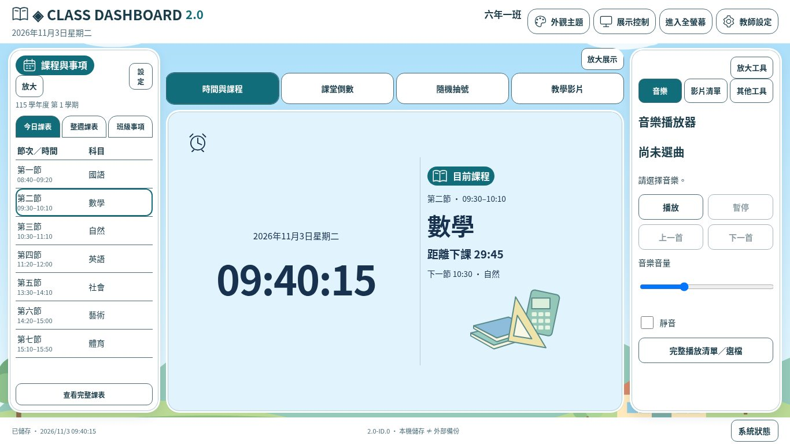
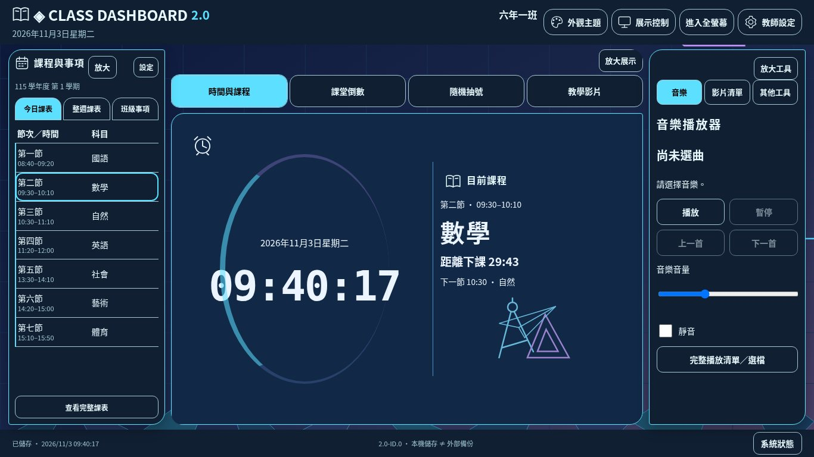
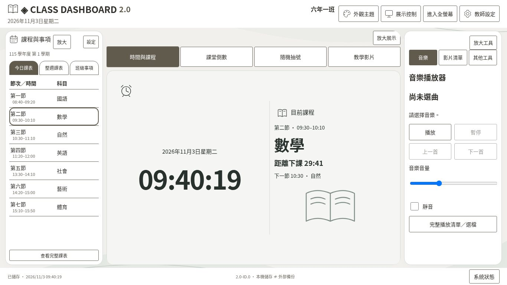
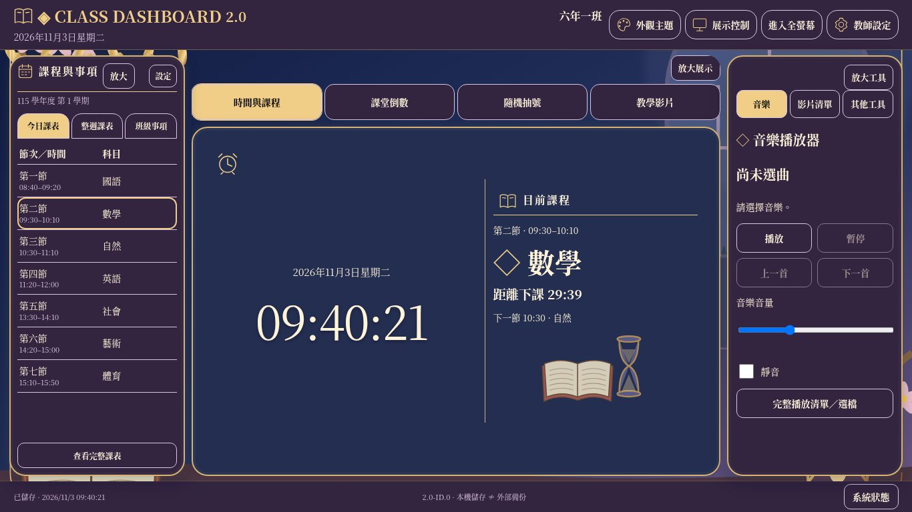

# Class Dashboard 2.0｜I-D整合驗收報告

**待審版本：2.0-ID.0／schemaVersion 8／JSON formatVersion 1**  
**基準：main 90fa70b（PR #12已合併）**  
**分支：review/class-dashboard-v2-integration-id**

## 結論

在本次可執行的Linux Chromium／Node檢查範圍內通過。發現兩項低風險顯示缺陷，已修正並回歸；沒有觀察到尚未修復的重大資料毀損或功能阻礙。**不是Windows11／實體白板／喇叭／第三方平台實播的全面驗收或正式上線核准**。這些未驗證項目及使用者視覺接受度仍需人工確認。

本次由對話中明確啟動I-D後執行，沒有背景監控或自動發布。只修改指定專案目錄，未合併main、修改Pages設定或開始第五階段。

## 發現與處理

| 編號 | 方法／預期 | 修正前實際結果 | 等級 | 修正與重測 |
| --- | --- | --- | --- | --- |
| ID-01 | 模擬兩次試聽resume回呼逆序；舊取消回呼不得改最新提示 | 音量0.5仍顯示「目前音量為0，已靜音」 | 低：訊息錯誤，未改資料或音量 | 引擎分開cancelled與靜音skipped，UI忽略已取消回呼；單元及瀏覽器重現後通過 |
| ID-02 | 真實兩分頁storage事件；隱私啟用後所有學生入口同步停用 | 設定已關閉、原入口與存取保護有效，但右側按鈕外觀仍可用 | 低：入口狀態不同步，沒有繞過保護 | 既有display隱私render同步右側入口，跨分頁及既有隱私回歸通過 |
| TEST-01 | 監聽器數量不得累積 | 初測10→23，看似增加 | 非產品缺陷 | 逐一查看回呼，新增13個全為Playwright命中攔截器；量測排除明確工具回呼，應用10→10，未更改產品來迎合數字 |

修正僅涉及提示音取消結果、提示音UI訊息及隱私入口同步；沒有重寫三欄或建立平行功能。兩個問題的修正前觀察與修正後紀錄見[id-test-results.txt](id-test-results.txt)。

## I-A功能與依賴盤點摘要

以下以本次實際原始碼整理既有成果，不是重新設計另一套系統。

```text
Class Dashboard
├─ 集中store：模型8／遷移／驗證／localStorage／Web Locks／過期分頁
├─ 班級：固定學生ID、姓名座號、今日參與、CSV/XLSX預覽確認
├─ 學校：共用作息、學期週課表、單日調課、臺灣日期時鐘
├─ 工具：唯一時間戳倒數、電子聯絡簿、同輪不重複抽號
├─ 顯示：三欄頁籤、六風格18配色、字級、可讀性、四專注、Fullscreen、隱私
├─ 聚焦：原DOM→原生模態／鍵盤返回，影片沿用專屬放大
├─ 提示音：同一設定／同一WebAudio→三音色、次數、試聽
├─ 多媒體：同一協調器→audio／video／官方YouTube adapter
│  └─ 網址庫、分類最愛排序、偏好、計時連動；本機Blob只在本次頁面
└─ 資料：完整JSON預覽確認還原，舊任務只保留歷史驗證，不恢復操作
```



| 功能群 | 實際入口／主要依賴 | 整合結果 |
| --- | --- | --- |
| 時間與課程 | 中央時間頁籤；school、clock、stage | 一張卡片同時顯示，不另存課程時間 |
| 課表與事項 | 左側三頁籤、完整／編輯；home、schedule、tools | 唯一聯絡簿資料，沒有重複卡片 |
| 課堂活動 | 中央倒數、提示音面板；timer、sound-settings、timer-link | 唯一deadline與音量分離 |
| 班級互動 | 抽號頁籤、參與設定；picker、classroom | 同輪不重複，ID及歷史不因座號更改錯置 |
| 教學多媒體 | 右側音樂／影片清單、中央影片、完整清單 | 固定原節點，互斥、切頁暫停、原生／官方控制 |
| 展示與管理 | 頂部、卡片放大、教師四頁；display、card-focus、overlay | 模態／專注／fullscreen分開，保留隱私 |
| 資料保護 | 資料管理；backup、migrations、store | 格式、預覽、確認、過期頁與寫入失敗防護保留 |

I-B成果詳見[視覺差異](visual-restoration-report.md)、[三欄整合](three-columns-report.md)；I-C成果詳見[提示音與聚焦](ic-completion-report.md)。本次不重做先前階段。

## 實際測試矩陣

[完整指令結果](id-test-results.txt) · [顯示／效能量測](id-display-measurements.json) · [90張截圖量測](id-geometry.json)

| 測試項目 | 方法 | 預期 | 實際 | 結果 | 等級／建議 |
| --- | --- | --- | --- | --- | --- |
| 核心、歷史、schema1～8 | npm test | 有效可遷移、ID／紀錄保留；壞／未來格式拒絕 | 90項通過 | 通過 | schema8未新增欄位 |
| 學生CSV/XLSX與範本 | id-classroom真實UI／檔案 | 30人、明確身分對應、重複拒絕、範本可下載 | 成功；ID／歷史保留，CSV有BOM、XLSX ZIP格式 | 通過 | Excel實機開檔未驗證 |
| 作息／課表／調課／學期 | 同上與核心 | 固定／今日／整週正確，匯入預覽、重疊拒絕、調課不改週表 | CSV、兩類XLSX、35筆課表、調課取消與學期沿用成功 | 通過 | 星期與臺灣日期另有單元覆蓋 |
| 聯絡簿 | 同上 | 編輯、排序、勾選、確認清除、刷新保存 | 成功，離線新增也保存 | 通過 | 不是離線首次載入保證 |
| 時間戳倒數／抽號 | 同上、既有browser | 刷新／暫停／繼續／到時不偏移，同輪排除不參與者 | 29次不重複、紀錄刷新保留，最大24h有界 | 通過 | 依電腦系統時間 |
| 提示音與連動 | 核心、I-C、三欄影音 | 3音效×1/2/3次、0／關閉／失敗、同設定保存與還原 | 模擬排程與真實WebAudio API通過，音樂不被試聽改音量 | 通過（API） | 喇叭聽感未驗證 |
| 舊三欄／聚焦回歸 | 既有四支browser腳本 | 三欄、四中央、四專注、鍵盤、隱私、單一節點 | 360布局、192字級、378聚焦情境通過 | 通過 | 18配色、五常見桌面尺寸 |
| 18配色×3可讀性×4字級×3尺寸 | id-display | 首頁無頁面／按鈕溢出 | 648組通過 | 通過 | 1920×1080、1366×768、1024×768 |
| 聚焦及管理視窗 | 同上 | 聚焦在視窗內、橫向不溢出，長內容可內捲 | 486聚焦、108教師／多媒體視窗通過 | 通過 | 使用最末特大字狀態檢查 |
| 小視窗／高縮放降級 | 同上 | 可讀捲動、不強裁重要按鈕 | 390×844、768×1024、1280×600無水平溢出 | 通過 | 垂直捲動為設計降級 |
| 極長班級名 | id-edge | 40字寬字元不碰工具列或出界 | 1024×768通過 | 通過 | 未刪文字迎合測試 |
| JSON備份與損壞復原 | classroom／I-C／核心 | 預覽確認，無效不覆蓋，含全部資料與新聲音欄位 | 下載／還原／損壞原始副本保護成功 | 通過 | 不是遠端同步 |
| Web Locks／跨分頁／隱私 | 單元及真實兩分頁 | 過期頁拒絕，隱私廣播關閉敏感介面 | 修正後通過，舊分頁不能改新資料 | 通過 | 隱私是畫面保護，非登入權限 |
| 本機與直接影音 | 既有媒體及資源腳本 | WAV/MP3/WebM/MP4解碼、互斥、進度、全螢幕 | 16次原生切換、原節點保留 | 通過 | HTTPS用本機路由替身 |
| Blob及媒體事件 | id-media-resources | 清空後精確釋放、事件不累積 | 4URL各撤銷一次，來源事件≤10；另有500次核心替身壓力 | 通過 | 不是數小時heap剖析 |
| 官方YouTube adapter | 路由／API替身 | 首次失敗可重試、100/101/150錯誤、延遲ready不復活 | 通過，iframe清理與原資料保留 | 模擬通過 | 不能代表外部平台實播 |
| UI資源穩定／reduced-motion | display及lifecycle | 不重建節點／主handler，不新增全域監聽、減少動作 | 節點相同、全域10→10、30聚焦循環狀態不變、抽號動畫0 | 通過 | 排除13個已確認的工具監聽器 |
| 靜態資源及正式站 | manifest與HTTP/API | 版本／路徑可驗證 | 本機77雜湊一致；正式HTTP/API 403 | 本機通過／正式未驗證 | 未改Pages設定 |
| Windows11 Chrome/Edge／白板／喇叭 | 當前無對應實機 | 真實操作／顯示／聲音 | 尚無結果 | 未驗證 | 需使用者人工驗收 |

原始任務、水族箱等已取消／停用的功能不應重新測作正常入口：正式頁未載入legacy操作，CHECK_IN被拒絕，歷史資料逐欄保留，視為符合目前產品方向。

## 效能證據與限制

固定源節點及主事件handler保留；全域應用監聽器10→10，另外排除13個已辨識Playwright攔截器。UI切換量測含自動化點擊／對話框／等待動畫幀，median 117ms、p95 145ms、max 181ms。**不是純渲染時間、FPS或Windows硬體效能保證**。程式碼另確認clock與app tick在初始化掛載，不在頁籤或聚焦中建立新interval／store訂閱。


沒有新增大型背景圖或影音寫入localStorage；原創SVG場景未改，審查JPEG不載入首頁。未做數小時真實使用、記憶體快照洩漏剖析、所有硬體GPU或所有外部影片來源，因此不宣稱完全不存在效能風險。

## 實際截圖與視覺結論

90張本次Chromium截圖：18配色×3尺寸的倒數聚焦＋設定，6風格×3尺寸首頁，以及6風格的時鐘／事項／工具聚焦。使用合成班級資料，無真實學生姓名。

已檢視六風格代表畫面與既有差異說明，並以全矩陣量測檢查18配色／字級／視窗；不把單元測試當美術驗收。原始參考PNG只有對話中的展示，未掛載原檔，**沒有逐像素比對**。目前採原創輕量SVG，與參考圖的繪畫材質、人物細節及光影仍有差異。三欄共用主構圖符合最新需求；高對比會刻意移除裝飾。是否達到使用者對美術還原的主觀期待仍待確認。

提示音設定是可捲動浮層，開啟時會覆蓋部分背景區域；收合恢復完整倒數展示。完整課表、長事項、清單及設定允許視窗內部捲動，不宣稱所有內容必須一次顯示。

### A 低年級童趣



| 畫面 | 1920×1080 | 1366×768 | 1024×768 |
| --- | --- | --- | --- |
| 首頁 | [截圖](screenshots/id/playful-candy-home-1920x1080.jpg) | [截圖](screenshots/id/playful-candy-home-1366x768.jpg) | [截圖](screenshots/id/playful-candy-home-1024x768.jpg) |
| 倒數聚焦／提示音 | [截圖](screenshots/id/playful-candy-timer-focus-sound-1920x1080.jpg) | [截圖](screenshots/id/playful-candy-timer-focus-sound-1366x768.jpg) | [截圖](screenshots/id/playful-candy-timer-focus-sound-1024x768.jpg) |

[時鐘聚焦](screenshots/id/playful-candy-clock-focus-1366x768.jpg) · [事項聚焦](screenshots/id/playful-candy-notes-focus-1366x768.jpg) · [工具聚焦](screenshots/id/playful-candy-widget-focus-1366x768.jpg)

### B 中年級活潑



| 畫面 | 1920×1080 | 1366×768 | 1024×768 |
| --- | --- | --- | --- |
| 首頁 | [截圖](screenshots/id/study-sun-home-1920x1080.jpg) | [截圖](screenshots/id/study-sun-home-1366x768.jpg) | [截圖](screenshots/id/study-sun-home-1024x768.jpg) |
| 倒數聚焦／提示音 | [截圖](screenshots/id/study-sun-timer-focus-sound-1920x1080.jpg) | [截圖](screenshots/id/study-sun-timer-focus-sound-1366x768.jpg) | [截圖](screenshots/id/study-sun-timer-focus-sound-1024x768.jpg) |

[時鐘聚焦](screenshots/id/study-sun-clock-focus-1366x768.jpg) · [事項聚焦](screenshots/id/study-sun-notes-focus-1366x768.jpg) · [工具聚焦](screenshots/id/study-sun-widget-focus-1366x768.jpg)

### C 高年級清新



| 畫面 | 1920×1080 | 1366×768 | 1024×768 |
| --- | --- | --- | --- |
| 首頁 | [截圖](screenshots/id/fresh-sky-home-1920x1080.jpg) | [截圖](screenshots/id/fresh-sky-home-1366x768.jpg) | [截圖](screenshots/id/fresh-sky-home-1024x768.jpg) |
| 倒數聚焦／提示音 | [截圖](screenshots/id/fresh-sky-timer-focus-sound-1920x1080.jpg) | [截圖](screenshots/id/fresh-sky-timer-focus-sound-1366x768.jpg) | [截圖](screenshots/id/fresh-sky-timer-focus-sound-1024x768.jpg) |

[時鐘聚焦](screenshots/id/fresh-sky-clock-focus-1366x768.jpg) · [事項聚焦](screenshots/id/fresh-sky-notes-focus-1366x768.jpg) · [工具聚焦](screenshots/id/fresh-sky-widget-focus-1366x768.jpg)

### D 青少年科技



| 畫面 | 1920×1080 | 1366×768 | 1024×768 |
| --- | --- | --- | --- |
| 首頁 | [截圖](screenshots/id/tech-electric-home-1920x1080.jpg) | [截圖](screenshots/id/tech-electric-home-1366x768.jpg) | [截圖](screenshots/id/tech-electric-home-1024x768.jpg) |
| 倒數聚焦／提示音 | [截圖](screenshots/id/tech-electric-timer-focus-sound-1920x1080.jpg) | [截圖](screenshots/id/tech-electric-timer-focus-sound-1366x768.jpg) | [截圖](screenshots/id/tech-electric-timer-focus-sound-1024x768.jpg) |

[時鐘聚焦](screenshots/id/tech-electric-clock-focus-1366x768.jpg) · [事項聚焦](screenshots/id/tech-electric-notes-focus-1366x768.jpg) · [工具聚焦](screenshots/id/tech-electric-widget-focus-1366x768.jpg)

### E 極簡專業



| 畫面 | 1920×1080 | 1366×768 | 1024×768 |
| --- | --- | --- | --- |
| 首頁 | [截圖](screenshots/id/minimal-warm-home-1920x1080.jpg) | [截圖](screenshots/id/minimal-warm-home-1366x768.jpg) | [截圖](screenshots/id/minimal-warm-home-1024x768.jpg) |
| 倒數聚焦／提示音 | [截圖](screenshots/id/minimal-warm-timer-focus-sound-1920x1080.jpg) | [截圖](screenshots/id/minimal-warm-timer-focus-sound-1366x768.jpg) | [截圖](screenshots/id/minimal-warm-timer-focus-sound-1024x768.jpg) |

[時鐘聚焦](screenshots/id/minimal-warm-clock-focus-1366x768.jpg) · [事項聚焦](screenshots/id/minimal-warm-notes-focus-1366x768.jpg) · [工具聚焦](screenshots/id/minimal-warm-widget-focus-1366x768.jpg)

### F 華麗展示



| 畫面 | 1920×1080 | 1366×768 | 1024×768 |
| --- | --- | --- | --- |
| 首頁 | [截圖](screenshots/id/elegant-royal-purple-home-1920x1080.jpg) | [截圖](screenshots/id/elegant-royal-purple-home-1366x768.jpg) | [截圖](screenshots/id/elegant-royal-purple-home-1024x768.jpg) |
| 倒數聚焦／提示音 | [截圖](screenshots/id/elegant-royal-purple-timer-focus-sound-1920x1080.jpg) | [截圖](screenshots/id/elegant-royal-purple-timer-focus-sound-1366x768.jpg) | [截圖](screenshots/id/elegant-royal-purple-timer-focus-sound-1024x768.jpg) |

[時鐘聚焦](screenshots/id/elegant-royal-purple-clock-focus-1366x768.jpg) · [事項聚焦](screenshots/id/elegant-royal-purple-notes-focus-1366x768.jpg) · [工具聚焦](screenshots/id/elegant-royal-purple-widget-focus-1366x768.jpg)

## 全18配色三尺寸截圖

| 風格／配色 | 1920×1080 | 1366×768 | 1024×768 |
| --- | --- | --- | --- |
| playful/candy | [截圖](screenshots/id/playful-candy-timer-focus-sound-1920x1080.jpg) | [截圖](screenshots/id/playful-candy-timer-focus-sound-1366x768.jpg) | [截圖](screenshots/id/playful-candy-timer-focus-sound-1024x768.jpg) |
| playful/ocean | [截圖](screenshots/id/playful-ocean-timer-focus-sound-1920x1080.jpg) | [截圖](screenshots/id/playful-ocean-timer-focus-sound-1366x768.jpg) | [截圖](screenshots/id/playful-ocean-timer-focus-sound-1024x768.jpg) |
| playful/forest | [截圖](screenshots/id/playful-forest-timer-focus-sound-1920x1080.jpg) | [截圖](screenshots/id/playful-forest-timer-focus-sound-1366x768.jpg) | [截圖](screenshots/id/playful-forest-timer-focus-sound-1024x768.jpg) |
| study/sun | [截圖](screenshots/id/study-sun-timer-focus-sound-1920x1080.jpg) | [截圖](screenshots/id/study-sun-timer-focus-sound-1366x768.jpg) | [截圖](screenshots/id/study-sun-timer-focus-sound-1024x768.jpg) |
| study/mint | [截圖](screenshots/id/study-mint-timer-focus-sound-1920x1080.jpg) | [截圖](screenshots/id/study-mint-timer-focus-sound-1366x768.jpg) | [截圖](screenshots/id/study-mint-timer-focus-sound-1024x768.jpg) |
| study/berry | [截圖](screenshots/id/study-berry-timer-focus-sound-1920x1080.jpg) | [截圖](screenshots/id/study-berry-timer-focus-sound-1366x768.jpg) | [截圖](screenshots/id/study-berry-timer-focus-sound-1024x768.jpg) |
| fresh/sky | [截圖](screenshots/id/fresh-sky-timer-focus-sound-1920x1080.jpg) | [截圖](screenshots/id/fresh-sky-timer-focus-sound-1366x768.jpg) | [截圖](screenshots/id/fresh-sky-timer-focus-sound-1024x768.jpg) |
| fresh/cream | [截圖](screenshots/id/fresh-cream-timer-focus-sound-1920x1080.jpg) | [截圖](screenshots/id/fresh-cream-timer-focus-sound-1366x768.jpg) | [截圖](screenshots/id/fresh-cream-timer-focus-sound-1024x768.jpg) |
| fresh/sage | [截圖](screenshots/id/fresh-sage-timer-focus-sound-1920x1080.jpg) | [截圖](screenshots/id/fresh-sage-timer-focus-sound-1366x768.jpg) | [截圖](screenshots/id/fresh-sage-timer-focus-sound-1024x768.jpg) |
| tech/electric | [截圖](screenshots/id/tech-electric-timer-focus-sound-1920x1080.jpg) | [截圖](screenshots/id/tech-electric-timer-focus-sound-1366x768.jpg) | [截圖](screenshots/id/tech-electric-timer-focus-sound-1024x768.jpg) |
| tech/cyber | [截圖](screenshots/id/tech-cyber-timer-focus-sound-1920x1080.jpg) | [截圖](screenshots/id/tech-cyber-timer-focus-sound-1366x768.jpg) | [截圖](screenshots/id/tech-cyber-timer-focus-sound-1024x768.jpg) |
| tech/aurora | [截圖](screenshots/id/tech-aurora-timer-focus-sound-1920x1080.jpg) | [截圖](screenshots/id/tech-aurora-timer-focus-sound-1366x768.jpg) | [截圖](screenshots/id/tech-aurora-timer-focus-sound-1024x768.jpg) |
| minimal/warm | [截圖](screenshots/id/minimal-warm-timer-focus-sound-1920x1080.jpg) | [截圖](screenshots/id/minimal-warm-timer-focus-sound-1366x768.jpg) | [截圖](screenshots/id/minimal-warm-timer-focus-sound-1024x768.jpg) |
| minimal/cool | [截圖](screenshots/id/minimal-cool-timer-focus-sound-1920x1080.jpg) | [截圖](screenshots/id/minimal-cool-timer-focus-sound-1366x768.jpg) | [截圖](screenshots/id/minimal-cool-timer-focus-sound-1024x768.jpg) |
| minimal/graphite | [截圖](screenshots/id/minimal-graphite-timer-focus-sound-1920x1080.jpg) | [截圖](screenshots/id/minimal-graphite-timer-focus-sound-1366x768.jpg) | [截圖](screenshots/id/minimal-graphite-timer-focus-sound-1024x768.jpg) |
| elegant/royal-purple | [截圖](screenshots/id/elegant-royal-purple-timer-focus-sound-1920x1080.jpg) | [截圖](screenshots/id/elegant-royal-purple-timer-focus-sound-1366x768.jpg) | [截圖](screenshots/id/elegant-royal-purple-timer-focus-sound-1024x768.jpg) |
| elegant/royal-blue | [截圖](screenshots/id/elegant-royal-blue-timer-focus-sound-1920x1080.jpg) | [截圖](screenshots/id/elegant-royal-blue-timer-focus-sound-1366x768.jpg) | [截圖](screenshots/id/elegant-royal-blue-timer-focus-sound-1024x768.jpg) |
| elegant/sakura | [截圖](screenshots/id/elegant-sakura-timer-focus-sound-1920x1080.jpg) | [截圖](screenshots/id/elegant-sakura-timer-focus-sound-1366x768.jpg) | [截圖](screenshots/id/elegant-sakura-timer-focus-sound-1024x768.jpg) |

## 修改檔案

- src/ui/sound.js、sound-settings.js：取消訊號與靜音分開，舊回呼不再覆蓋最新試聽訊息。
- src/ui/display.js：跨分頁隱私render同步右側學生入口。
- tests/ic.test.js：取消結果的明確斷言；tests/id-classroom-browser.cjs、id-display-browser.cjs、id-lifecycle-browser.cjs、id-media-resources-browser.cjs、id-edge-browser.cjs：本次新增可重跑驗收。
- tools/capture-id.cjs、package.json、version.json、tools/release.mjs、版本顯示與tests/version.test.js：I-D小修版本與工具。
- README、Windows11／Pages指南、本報告、結果／量測JSON、90張截圖。其餘module主要為快取版本查詢字串同步，不是資料模型／業務邏輯重寫。

資料仍schema8／JSON格式1，學生ID、作息課表、聯絡簿、抽號、影音、提示音偏好及歷史不變；沒有新遷移或初始化清空。載入與保存防護仍沿用原架構。

## 可重跑指令

repository根目錄提供HTTP，於class-dashboard-v2/執行（Playwright與Chromium需可用）：

```sh
npm test
TEST_URL=http://127.0.0.1:8014/class-dashboard-v2/ npm run test:browser
TEST_URL=http://127.0.0.1:8014/class-dashboard-v2/ npm run test:id
TEST_URL=http://127.0.0.1:8014/class-dashboard-v2/ npm run capture:id
node tools/check-deployment.mjs http://127.0.0.1:8014/class-dashboard-v2/
```

本機port可自行替換。舊版UI腳本留供歷史提交，不將它們冒稱目前全部通過；本次將班級／課表流程明確改為目前UI重新執行。核心測試全部執行。

## 人工驗收及GitHub狀態

[Windows11人工清單](windows11-guide.md)。先備份，依三尺寸／實際可用高度試三欄、18配色、字級／高對比、聚焦／Esc、匯入／還原；聽三音色、次數與0音量、快連點試聽；測音樂影片／原生進度／合法YouTube／計時連動。兩分頁驗過期拒絕及隱私廣播。須完成實際Chrome／Edge、白板、喇叭及視覺接受度確認，才由使用者決定上線。

Git確認main已含I-C PR #12；本次修正仍在新分支，未合併、未關閉其他PR、未修改正式網站。API及正式站HTTP受限，不能以本機hash判斷正式已更新。Git推送與PR建立實際結果見交付訊息；若API Forbidden，只提供建立入口，不宣稱PR完成。

I-D完成後停止，不進入第五階段。
