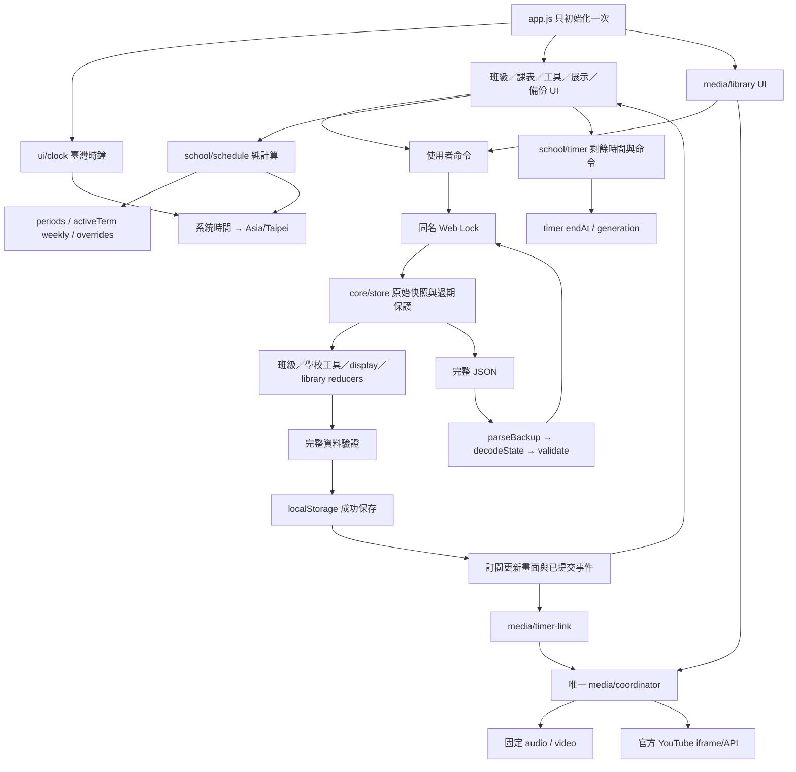
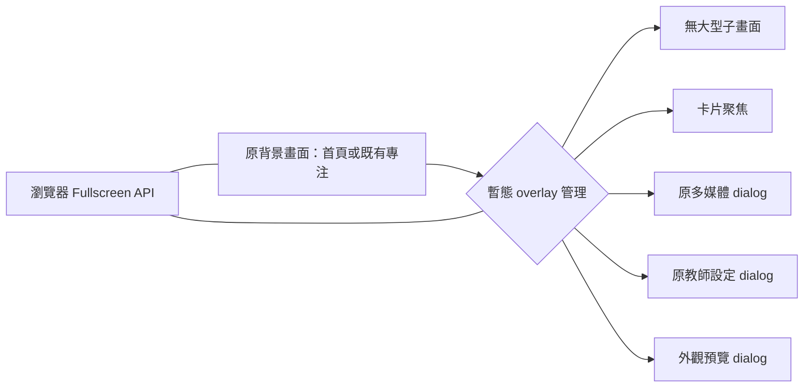

# I-A｜第一～四階段功能與依賴盤點

日期：2026-11-03（臺灣）。本批次**僅分析與設計**，不實作 I-B、I-C、I-D，不改功能程式、資料模型、網站版本、發布設定或正式站。

## 1. 實際基準與範圍

- Repository：`Haohmazu/-`；唯一分析／交付目錄 `class-dashboard-v2/`。
- 最新 main：`fb84a57`，合併 4D 的 PR #7；對應功能提交 `9270ff8`。
- 實際 HTML、app、release 與 version.json：`2.0-stage4D.0`；`DATA_VERSION = 6`，48 個受版本清單管理的 HTML/CSS/JS 資源。
- 本批次分支：`develop/class-dashboard-v2-integration-ia`，由最新 main 建立，起始工作區乾淨。
- 使用者回報 4D 已上線且正常；這是使用者驗證。本環境 GitHub Pages API 為 Forbidden、公開 Pages 連線為 CONNECT 403，不能獨立核對即時部署來源、HTML/CSS/JS 或快取。Git main 原始碼已核實，不將它冒充正式站 HTTP 驗證。
- 最後執行指示限定 I-A。文件中 I-C 的開發細則列為後續相依規格，這次不執行；未來 I-C 開工前必須確認 I-B 已實作並通過驗收。
- 任務操作仍停用、水族箱已取消；自主學習／閱讀活動中心僅候選，本次不設計其功能或操作入口。

下列「現況」均來自本次實讀程式；「建議」是待確認方案，不代表已開發。

## 2. 功能整合樹狀圖（目標資訊架構）

```text
Class Dashboard 2.0（同一個 app / store）
├─ 系統工具列
│  ├─ 班級／日期摘要、教師設定
│  ├─ 外觀預覽→確認／取消〔I-B〕
│  └─ 展示：全螢幕、既有專注、隱私、字體、原有布局
├─ 教室時間中心〔合併展示，沿用時鐘與作息計算〕
│  └─ 日期／時間、目前節次／科目／時間、下課倒數、下一節／開始時間
├─ 課程與事項中心〔I-B 頁籤〕
│  ├─ 今日課表（含單日調課）
│  ├─ 整週固定課表（仍引用作息）
│  └─ 班級事項摘要 → 完整聯絡簿〔I-C 聚焦〕
├─ 課堂活動中心
│  ├─ 唯一手動倒數、常用時間、開始／暫停／繼續／重設／增減
│  ├─ 既有影音連動設定 → 原多媒體視窗
│  └─ 同一份提示音設定、試聽與三種音效〔I-C〕
├─ 班級互動中心
│  ├─ 同一份抽號：結果、已抽／剩餘、手動重設
│  └─ 今日參與／排除 → 既有教室工具設定（隱私檢查）
├─ 教學多媒體中心〔保持單一原有 dialog〕
│  ├─ 音樂／影片分頁、本機暫存、HTTPS／官方 YouTube
│  ├─ 保存網址、分類、最愛、排序、搜尋、一鍵播放
│  ├─ 同一播放協調器、互斥、生命週期與音量偏好
│  └─ 音樂背景播放 → 首頁迷你控制列
├─ 教室展示〔共用原卡片、同一資料來源〕
│  ├─ 既有四種專注：時鐘／倒數／今日課表／抽號
│  └─ 卡片置中聚焦〔I-C，暫態 dialog，不複製核心〕
│     └─ 時間、今日／整週課表、聯絡簿、倒數、抽號
└─ 教師設定與資料管理〔保留原四分頁〕
   ├─ 班級／學生／CSV/XLSX 範本與身分確認匯入
   ├─ 學期／作息／固定課表／範本匯入／單日調課
   ├─ 教室工具：倒數、提示音、聯絡簿、參與／抽號
   └─ JSON 下載、驗證→預覽→明確確認還原、原始資料保護副本
```

整合的是資訊呈現與入口。作息倒數、手動倒數、抽號、影音、事項仍是各自的權威資料，不合併成一份「活動狀態」。

## 3. 正式功能、現有入口與目標區域對照

| 功能 | 實際入口／DOM | 實際模組與資料 | 建議整合與批次 |
| --- | --- | --- | --- |
| 班級名稱／學生名單 | 首頁 `#class-name`、頁首 `#open-roster`；設定「班級與學生」 | ui/controller、features/classroom；classroom、students | 班名移到精簡工具列；完整名單保持管理視窗，不放投影首頁〔I-B〕 |
| 學生逐筆新增／編輯 | `#class-form`、`#student-form`、`#student-list` | 固定 students.id；座號 1–50、姓名選填 | 功能與 ID 規則保留；不得複製名單編輯器 |
| 學生 CSV/XLSX 範本／匯入 | `#roster-import`、`#csv-template`、`#xlsx-template`、`#roster-file` | ui/roster-import、io/roster、xlsx、zip；rosterImports | 留設定內，預覽、明確身分對應與確認不可精簡掉 |
| 日期／臺灣時鐘 | 中央 `.clock-card`，`#date`、`#clock` | ui/clock；Intl Asia/Taipei，當前時間衍生 | 與目前課程集中為時間中心〔I-B〕；聚焦沿用同一節點〔I-C〕 |
| 作息／目前節次／科目／下課倒數／下一節 | `.course-now`，current-period/course、school-countdown、next-course | ui/schedule、school/schedule/time；school.periods＋activeTerm | 目前已在時鐘下方集中；去掉分散重複下一節字串，保留重要資訊 |
| 學期、作息設定 | 設定「作息與課表」，term-select、term-form、period-form | school/commands/validation；periods 共用、terms 保留舊學期 | 仍在教師設定；首頁只呈現目前學期摘要 |
| 今日／整週課表 | `.timetable-card`、`#view-today`／`#view-week`、`#schedule-table` | ui/schedule 的暫態 mode；courseAt/todaySchedule | 升為今日／整週／班級事項三頁籤，鍵盤與觸控可用〔I-B〕 |
| 固定課表／CSV/XLSX 匯入 | 設定 `#course-form`、`#timetable-import` | terms[].weekly，時間引用 periods；io/timetable | 保留原設定、範本及確認流程，不新增第二份課表 |
| 指定日期臨時調課／取消 | 設定 `#override-form`、`#override-list` | terms[].overrides[date][periodId] | 保留此模型；今日標記臨時，整週仍明示固定課表；頁籤提供設定捷徑 |
| 手動活動倒數／常用時間 | `.timer-card`，timer-start/pause/reset/plus/minus、data-preset | school/timer；timer.endAt、status、generation | 保留首頁基本按鈕，詳細設定走 dialog，聚焦移用同卡〔I-C〕 |
| 計時提示音 | 設定「教室工具」`#sound-form`，核取方塊＋音量＋保存 | preferences.timerSound/volume；ui/sound | 開關、百分比、三音色、試聽、次數〔I-C；I-B 不提前開發〕 |
| 電子聯絡簿完整展示／CRUD／排序／完成 | 右欄 `#notes-display`；設定 note-form/editor、clear-done-notes | ui/tools；notes[{id,text,done}] | 頁籤摘要〔I-B〕；完整閱讀與必要編輯於聚焦／原設定〔I-C〕 |
| 隨機抽號／本輪紀錄 | `.picker-card`，draw-student/result、picker-remaining/drawn | ui/tools、school/commands；picker | 簡潔結果與數量；完整已抽／剩餘座號可在聚焦顯示〔I-C〕 |
| 今日參與排除／手動重設 | 設定「教室工具」participation-editor、reset-picker | participation[臺灣日期][studentId]、picker.drawn | 入口靠近抽號，但仍經隱私保護。現在剩餘只顯示人數，剩餘座號為可衍生資訊，尚無專屬清單 |
| 全螢幕／四專注／字體／三主題／三布局／隱私 | `.quick-tools` 的各選單、按鈕、shortcut-help | ui/display；display model、Fullscreen API | 工具列改分組／子畫面；舊欄位相容，18 外觀方案〔I-B〕 |
| 快捷鍵／reduced-motion | document keydown、display/shortcuts、CSS | 非輸入狀態快捷鍵；尊重系統動作偏好 | 保留，新增 dialog 時納入同一忽略／Esc 策略〔I-C〕 |
| 音樂／影片／YouTube／暫存佇列 | `#open-media` → `#media-center` 音樂／影片頁籤 | ui/media、media/coordinator/sources/youtube；原生 audio/video | 保留唯一視窗與播放器；首頁不放大型播放器 |
| 保存網址／分類／最愛／排序／搜尋 | media-center 的 library-section | ui/library、library/model/commands；mediaLibrary | 保留內部必要捲動；只接入新外觀 tokens，不重寫功能 |
| 計時開始／暫停／結束影音連動 | media-center → `#timer-link-details`／form | media/timer-link；mediaLibrary.timerLink | 活動中心提供開啟該設定的捷徑，不建立另一套連動設定 |
| 背景音樂迷你列 | 首頁 `#music-mini` | 同一 coordinator 的當前音樂；暫態 | 需計入首頁高度，保留可操作控制，不直接隱藏以滿足無捲軸 |
| 完整 JSON 備份／還原／保護副本 | 設定「資料管理」，export-json/recovery、restore-file/preview | ui/backup、io/backup；完整 getState | 確認與隱私不變，預覽可內捲；新偏好隨完整備份自動納入但需驗證 |
| 儲存／錯誤／版本提示 | footer、notice/form-error/quick-notice/startup-status | ui/dom、controller、app | 整理重複通知，但錯誤要可讀、可查看，不裁切／靜默隱藏 |
| 停用任務歷史 | 無正式操作入口 | templates、rounds、rosterImports；task-validation/settlement 驗證；legacy 未載入 | 只保留／備份／遷移，不能為互動中心重新載入 legacy |

沒有正式功能：卡片 modal 聚焦、班級事項頁籤、六種新風格／18 配色、外觀預覽確認取消、提示音試聽／音色／次數、閱讀活動中心。不能以本次盤點稱為已完成。

## 4. 功能依賴圖與更新順序



需保持：**命令 → 驗證新狀態 → 保存成功 → 更新畫面 → 影音／提示音副作用**。`createMediaCoordinator` 本身不拿 store；暫態播放不能變更學生或課表。

### 一次性初始化與反覆呈現的界線

- app 一次 mountDisplay／mountUI／名單匯入／課表／工具／備份／media。不可在每次頁籤、主題或聚焦時再次呼叫 mount，否則重建事件與 AudioContext／播放器。
- 現有時鐘一個每秒 interval；app 另有一個每秒 interval 更新課表與工具，visibilitychange 重新同步。聚焦不得再開新倒數 interval。
- 每筆成功命令會通知訂閱者；ui/tools、schedule、library 以 signature 避免不必要重建。若新增視圖，優先共用 render，不在開／關 dialog 時增加永久訂閱。
- `getDisplayState()` 刻意不包含 rounds/templates/rosterImports；一般展示不要改用完整歷史狀態並把隱私資料帶上主畫面。
- 重要修訂會改 revision；目前匯入／還原預覽會拒絕任何預覽後的資料改動，包含外觀設定成功保存。不能為「方便」略過過期檢查；應提示重新預覽。

## 5. 資料模型、保存與備份盤點

| 欄位 | 現況與相依 | 未來注意 |
| --- | --- | --- |
| schemaVersion / revision / savedAt | 6；全域遞增修訂及成功時間 | I-A 完全不改；真正新增欄位才遷移 |
| classroom / students | 班名；最多 50 人，固定 id、可改 seat、選填 name | 不按姓名合併身分，不因換版重建 ID |
| participation | 每日臺灣日期 → studentId → boolean | 今日排除不影響既有歷史；抽號使用當日資料 |
| school.periods | 最多 40 個有效不重疊時段，共用於所有課表 | 首頁減量不能刪時段；不以每科重存時間 |
| school.activeTermId / terms | 學年／學期／weekly／overrides；最多 40 學期 | 單日異動不覆蓋 weekly；切換目前學期由教師明確操作 |
| timer | durationMs、remainingMs、endAt、status、generation | 唯一手動倒數；作息倒數只是衍生時間，不共用此狀態 |
| notes | 最多 100 項，每項最多 300 字，id/text/done，陣列順序 | 摘要只改呈現，不截短保存的文字 |
| picker | round、drawn studentIds、lastId | 剩餘名單與已抽數衍生；不另存可能矛盾的計數 |
| preferences | `{timerSound:true, volume:0.5}` 預設 | 與媒體音量分開；I-C 新音色／次數需驗證與遷移 |
| display | focus home/clock/timer/schedule/picker、privacy、layout standard/clock/schedule、font 四級、theme ocean/light/contrast | 嚴格欄位白名單，不可直接塞 style/palette 而不改驗證 |
| mediaLibrary | categories、items、preferences、timerLink；上限 50 分類／500 網址 | 保留 ID／最愛／陣列順序，播放器偏好與提示音獨立 |
| templates / rounds / rosterImports | 舊任務範本／歷史／結算資料；名單匯入記錄 | 保留且持續驗證，不重新啟用命令 |
| 不保存內容 | Fullscreen API 狀態、課表 mode、播放器與本機 Blob、未保存表單草稿 | 聚焦／頁籤／預覽草稿也建議保持暫態 |

儲存鍵只有既有 `class-dashboard-v2`；不操作舊 `aquarium-classroom-v1`。讀取僅在記憶體遷移，第一筆成功命令才寫回。損壞資料鎖定一般寫入，保留 raw 副本；嚴禁清空重設。

Web Locks 使用 `class-dashboard-v2-write`；store 比對完整 raw baseline，拒絕同 revision 外部改寫與過期分頁。還原需 confirmed 與 expectedRevision。不要在新外觀／聚焦模組直接呼叫 localStorage.setItem。

JSON 外層是 `{app:'class-dashboard-v2',formatVersion:1,exportedAt,data}`，最大 8 MB，data 是完整 getState；parseBackup 經 decodeState 與驗證。還原預覽及勾選確認保留，成功後 revision 使用目前值＋1。媒體檔案及 Blob 不入 JSON，下載不代表同步。

### 後續遷移建議（未執行）

- I-B 若新增持久化外觀，可採 schema 6→7，只加 `appearance`；原 display 欄位原值不動。之後 I-C 若加提示音欄位，再由實際 I-B 版本升版（例如 7→8），**不能在這次先鎖死編號或假設 I-B 已完成**。
- 每次遷移均測各歷史 fixture、原學生 ID／歷史與當前全部新偏好；讀取不自動寫回。拒絕未來版，不把缺欄位的當前版當新資料重設。

## 6. 介面與 CSS 的實際耦合

### 現有三個樣式檔

1. `styles/main.css`：基礎 UI、三欄／兩欄／手機布局、表單、dialog、表格。1100px 以下右欄另起一整列，680px 以下縱向；目前為內容流，自然允許頁面垂直捲動。
2. `styles/display.css`：三主題 tokens、字體 scale、三布局排序、四專注隱藏／放大、短投影螢幕安全上限、隱私、reduced-motion；在 main.css 之後載入。
3. `styles/media.css`：唯一媒體 dialog、迷你列、網址庫；大多依賴同一套 tokens，也有 `body[data-theme=light]` 的特殊前景色規則。

Tokens：`--page --card --text --muted --border --surface --clock --accent --error --feedback --display-scale`。現有 header、部分 primary 控制等仍有固定顏色及 theme 特例。18 配色不能只加背景，需盤點按鈕／選取／禁用／錯誤／焦點／進度條／媒體／對話框狀態色，避免不同檔案的優先級互相覆蓋。

現有專注透過 `body[data-focus]` 隱藏其他卡片，**並沒有第二份時鐘／計時器／抽號 DOM**。部分 selector 不只限 main，例如 `body[data-focus=timer] .clock-card`；未來把卡片移入 dialog 時，可能仍被舊專注 selector 隱藏，必須界定 main 與聚焦 dialog 的樣式範圍。

課表每週 table 有 570px 最小寬度，`#schedule-table` 允許內部水平捲動。這與「首頁無頁面水平捲軸」是兩件事：I-B 還需確保所需科目可讀、操作可達，不能靠外框裁掉週五。聯絡事項及已抽座號目前長度會讓首頁自然長高；通知、展開快捷說明及背景音樂迷你列也佔實際高度。

## 7. 單螢幕首頁整合建議

### 建議空間策略

- 上方一列精簡工具列：品牌／班名／日期摘要、外觀、展示、全螢幕、教師設定。原本多個選單與快捷說明整理成外觀與展示子畫面，首頁保留必要直接入口，不刪功能。
- 核心時間區固定保留：時間／目前節次與科目／課程時間／下課剩餘／下一節。它現在已有單一計算來源，只調位置及重複字串。
- 課程事項共用一卡三頁籤，不能同時擠出三個完整區塊。今日顯完整當日節次；整週用寬區／可放大；事項顯有限筆數＋「其餘 N 項／查看全部」。摘要有明確完整入口，不用 ellipsis 讓關鍵文字永久讀不到。
- 計時器保留開始／暫停／繼續／重設與合理快捷時間；增減與詳細設定可在同卡展開或下一批聚焦，不能把完成操作必要按鈕裁掉。抽號保留大座號／按鈕／人數，長已抽清單改摘要與詳情。
- 背景音樂迷你列做精簡可操作列，計入可用高度；錯誤、儲存與版本也預留可讀摘要／詳情位置。不要移除重要錯誤來假裝無捲軸。

### 尺寸與可用高度

以 `window.innerWidth/innerHeight` 及 `100dvh` 為布局依據，不以顯示器標稱 1920×1080 當可用內容高度。測 16:9、16:10、4:3，並加低高度例（1366×660）模擬工具列佔用。

建議桌面 shell 分成工具列／時間主區／內容區／狀態及迷你列，以 Grid 和 minmax(0,1fr) 分配剩餘空間。短螢幕先縮裝飾／間距，再用頁籤與摘要，不能只設 body overflow:hidden。一般尺寸與標準縮放應無頁面雙向捲軸；設定、媒體、完整內容 dialog 可內捲。

手機、200% 高縮放或極高字級時，以可讀和可操作優先，允許文件垂直流並記錄降級；不可用裁切或縮至難讀的字體硬通過。特大字＋完整整週 40 節次不可能保證單屏全部展開，應用清楚摘要／放大完整閱讀，而不是改掉資料。

### 現況量測

本次以獨立 Chromium 測試 profile、合成 30 人／10 則聯絡事項／既有 7 授課節次、標準布局、臺灣平日時間測量；不是讀取教師私人 localStorage。結果見文末附錄。這是 I-B 的問題基線，不是已完成新首頁，也不把既有允許捲動的 4D 判作功能回歸失敗。

## 8. 六風格／18 配色相容方案（I-B 待確認）

建議只增加一個 appearance 資料物件，例如 `{style:'legacy',palette:'default'}`。`legacy/default` 是兼容預設，不計入六種新風格；新風格只能選其三種合法配色，資料驗證使用配對白名單。

- 保留 `display.theme` 的 ocean/light/contrast 不變，作為舊版主題與可讀性選項。legacy 完整復現原三主題。選六風格時 ocean／light 使用該風格配色的深／淺可讀 tokens 變體，名稱與提示要明示，以免選明亮卻看到深色。
- `display.theme === 'contrast'` 是最高優先的對比覆層，不論哪個風格／配色，統一使用高對比文字、邊框、焦點與狀態色，減少裝飾；退出高對比後恢復原選的配色。保留六風格的結構標識，但不犧牲可讀性來追求裝飾。
- 新增外觀 dialog 用暫態 draft 預覽。預覽只對呈現 roots 套用 draft tokens／樣式，不 dispatch、不改 revision；取消／Esc 恢復已保存外觀。確認才命令驗證→保存→正式套用；失敗保留舊狀態並回復預覽，不能先顯示已保存。
- 不以重建 DOM、iframe 或重新 mount 實作換風格。字體 scale、privacy、layout 仍是原欄位；樣式（設計語言）與布局（資訊排序）分開，保留三布局選擇，不以年級綁定。
- 原生 HTML/CSS／小型原創裝飾即可；不引進大型圖片、外部字型／付費素材。動作尊重 reduced-motion；高對比禁用不必要裝飾動畫。

| 風格與三配色 | 結構／視覺差異，不只換底色 | 需檢查 |
| --- | --- | --- |
| A 童趣：彩虹糖果／海洋冒險／森林樂園 | 大型圖示、圓潤輪廓、原創小插畫，資訊精簡 | 裝飾不侵佔必要按鈕，圖示附文字 |
| B 活潑學習：陽光校園／薄荷創意／莓果活力 | 彩色分區、文具標籤／紙張層次、清楚區塊標記 | 不以顏色作唯一狀態指示 |
| C 清新資訊：天空青綠／奶油暖橘／鼠尾草綠 | 規整資訊網格、較細框線、科目層級清楚 | 密度與字級保持可讀 |
| D 科技：霓虹電光／賽博紫夜／極光綠黑 | 幾何框架、數位讀數、節制科技動畫 | 對比、低負載、reduced-motion |
| E 極簡：暖白灰階／冷白藍灰／深灰極簡 | 低裝飾、清楚排版、留白與細分隔 | 短螢幕留白可縮，不能擠掉資訊 |
| F 華麗：紫金星夜／皇家藍金／櫻花琉璃 | 漸層背景、細框與層次，適合展示 | 半透明底上文字對比、焦點可見 |

每配色都必須定義背景、卡片、文字、次要文字、按鈕前景／背景、邊框、強調色、成功／錯誤、選取／禁用／鍵盤焦點。一般文字以 WCAG AA 4.5:1、大字及必要非文字控制對比以 3:1 作驗收目標，不能只看漂亮截圖。

## 9. 卡片聚焦、專注與視窗共用方案（I-C 待確認）

### 權威狀態不重複

優先使用原卡片 DOM，在開啟單一 `dialog` 時移入所選卡片，原位置留 placeholder，關閉時移回；不要 cloneNode 複製 id、播放器、事件，或第二次 mountTools／startClock。現有 tick 用 document 查 ID，移到 dialog 仍可更新同一節點。課表／聯絡簿的完整呈現可經原 render 加展示參數，不能另造一份課表／notes 狀態。

移動 DOM 方案需先做小型技術驗證：CSS main/body selector、container queries、原有欄位更新、回填 placeholder、對話框焦點、原生全螢幕。若為了不同排版採共用 render 到唯讀容器，也須無重複 ID、無新權威狀態，操作一律 dispatch 舊命令；不能無評估同時養兩份獨立視圖。

### 狀態關係



- 原 `display.focus` 持久化不變；新增 card target／開啟來源／placeholder／返回位置為 runtime 狀態，關閉恢復原專注，不為一次放大寫入 localStorage。
- overlay 控制只協調原 dialog 的開關，不建立第二套媒體生命週期。同時最多一個大型子畫面。關閉媒體必須走原 close/cancel 清理：音樂可留背景、影片停止。
- 卡片右上關閉與 Esc、原生 showModal 背景 inert、鍵盤限制在視窗、關閉回觸發按鈕、觸控最少 44px。只綁放大按鈕，不攔整卡，避免按開始／抽號變成開視窗。
- Esc 優先目前 modal，瀏覽器保留全螢幕的原生退出行為；不要假設一次 Esc 可同時關兩層。無 dialog 才交回既有專注／全螢幕邏輯，需 Chrome/Edge 實測。
- 設定／參與／聯絡簿編輯與還原仍先查投影隱私；聚焦可展示座號及公開事項，但不能帶出姓名。聯絡簿必要編輯若會開教師設定，先經同一隱私 guard。
- 切換頁籤保留未保存表單，不關閉／重建設定。現有設定關閉會 reset 學生編輯表單，不能為切展示模式順手關設定而宣稱草稿保留；跨 overlay 若有草稿需暫存或明確處理。
- 整週固定課表不得為顯示臨時標記改寫週資料；今日用原 overrides，整週可註記「今日另有調課，查看今日」，保持語意清楚。

## 10. 計時提示音現況與 I-C 計畫

已讀 `ui/sound.js`：單一 AudioContext 懶建立，第一次 pointerdown／keydown 嘗試 resume；已保存 `preferences.timerSound` 與 `volume` 控制。現行完成聲是 **784 Hz、3 個短音、間隔 0.3 秒、每音 0.16 秒、增益 volume×0.15**。沒有音色、播放次數或試聽；不能憑需求書說已具備。

`ui/tools.tick` 在倒數到時提交 TIMER_FINISH（generation 驗證）成功後才呼叫 sound；finishing 與 finishAttempt 避免重複。聲音失敗目前靜默，不影響倒數文字。`SET_SOUND` 在 school/commands **直接取代整個 preferences 物件**，I-C 若新增欄位必須同步修正命令及驗證，否則舊入口保存會丟掉新偏好。

建議 I-C 延伸原 sound 服務，而非第二套：

- 原 preferences 保留 timerSound／volume，增加如 `soundType:'electronic'`／`soundRepeat:1`（正式名稱待實作確認）。`soundRepeat` 定義為「完整音效播放幾次」。電子音保留原三短音為一組，預設完整一組一次，以沿用既有體驗；避免設預設 3 組而變成 9 個短音。
- 柔和鐘聲、清晰鈴聲用原創 Web Audio 合成與增益包絡區別，不引進不明授權素材。手動試聽可忽略開關但遵守目前音量，音量 0 明示靜音；不 dispatch 計時命令、不改剩餘時間／generation。
- 共用一個音效設定元件／render，教師設定與計時器聚焦綁同一份已保存 preferences；開關成功保存才套用，失敗回復。滑桿顯百分比，草稿試聽與正式已保存值須清楚區別。
- 同一 sound 服務需可取消／替換上次試聽、限制重複點按與有界排程，回收 oscillator/gain；只保存後完成事件能觸發正式提示。媒體播放器音量與提示音 AudioContext 不混為一體。
- 解鎖／resume 失敗應回傳結果供中文提示，不能沿用目前完全靜默而聲稱試聽成功；文字「時間到！」及已保存完成狀態不依賴音訊成功。
- 加入遷移／完整備份／還原／兩入口同步、Quota 回復、零音量／關閉、連按試聽、不重複完成及音訊拒絕測試；真實音色可辨識與喇叭音量仍需 Windows 人工驗收。

## 11. 建議修改檔案與責任範圍（本批次未修改）

| 檔案 | I-B 建議工作 | I-C 建議工作 |
| --- | --- | --- |
| index.html | 工具列分組、時間區、三頁籤／摘要、外觀預覽 dialog | 放大按鈕、單一 card dialog、提示音兩入口 |
| styles/main.css、display.css | 可用高度 Grid、短螢幕摘要策略、既有專注範圍 | 聚焦重用 DOM 與放大尺寸、返回／內捲 |
| styles/media.css | 新 tokens 相容、迷你列高度，不改播放 | 聚焦／媒體切換清理與遮蔽層級 |
| 建議 styles/appearance.css、src/display/appearance.js | 六結構風格／18 配對 tokens、暫態預覽與保存 | 只延用，不重建外觀系統 |
| ui/schedule.js、ui/tools.js | 暫態頁籤、notes 摘要與共用呈現接口 | 全內容聚焦、同一倒數／抽號操作 |
| ui/display.js、display/model.js、shortcuts.js | 原主題／布局／隱私相容及入口 | 舊專注與 overlay 的 Esc／焦點協作 |
| 建議 ui/overlay.js、ui/card-focus.js | I-B 可先讓 appearance 走共用 overlay，避免之後平行管理 | 同一 overlay 加卡片；原卡片移動與恢復 |
| ui/dom.js、controller.js、media.js | 新入口及隱私 guard；不得重建 media | 跨視窗協調、草稿／返回位置、保留原媒體 close 行為 |
| core/model/migrations/validation/store | 外觀的必要遷移／驗證／命令 | 依實際版本增提示音驗證／遷移；不繞過鎖 |
| school/model/commands/validation、ui/sound.js | 不提前擴充音效 | 延伸原 preferences、SET_SOUND、同一音效服務及試聽 |
| ui/backup.js、io/backup.js | 完整備份測新欄位，必要時補預覽摘要；不換備份外層 | 聲音偏好往返與失敗保護 |
| tests/、tools/release.mjs、version.json、README、docs | 新版相容、外觀／頁籤／尺寸矩陣與操作說明 | 聚焦／提示音／回歸與 Windows 驗收 |

這是建議依賴清單，未授權前不建立這些功能檔案；實際檔案切分仍以避免重複初始化為準。

## 12. 風險清單與處理方式

| 風險 | 重要性 | 處理與驗證 |
| --- | --- | --- |
| body overflow:hidden 假通過、短螢幕裁掉按鈕 | 高 | 量 DOM scrollWidth/Height、元素可見與可點、長內容／通知／迷你列；摘要附完整入口 |
| 40 時段、100×300 字事項、50 人已抽清單無界撐高 | 高 | 不改資料上限；展示摘要／頁籤／完整 dialog，清楚列測試量與降級 |
| clone 卡片造成重複 ID、計時／播放兩套 | 高 | 原 DOM／共用 render；固定 mount、interval、audio/video 與訂閱數測量 |
| 舊 body-focus CSS 隱藏新 dialog 內容 | 高 | 界定 selector 作用範圍，所有舊專注×新聚焦組合測試 |
| display 白名單或 SET_SOUND 取代物件導致丟欄位 | 高 | 正式遷移與完整模型驗證、舊 fixture／新備份往返 |
| appearance 與舊主題三套機制互相覆蓋 | 高 | 一組 tokens 解析順序，高對比最後覆層，18 配色合法配對及明亮相容明示 |
| 隱私下透過新快捷入口顯示姓名／匯入明細 | 高 | 同一 settingsAccess，測新 dialog／跨頁 storage 隱私事件 |
| 多 dialog 遮疊、Esc 誤關、焦點掉到背景 | 高 | 單 overlay 協調器、showModal inert、返回焦點、全螢幕原生實測 |
| 外觀保存使匯入／還原 preview revision 過期 | 中 | 保留拒絕，提示重新預覽；預覽 draft 不寫 store |
| 切換介面關設定丟未存學生／課表草稿 | 高 | 不重新 mount，不因頁籤 close 設定；明確草稿保存／返回政策 |
| 試聽與完成聲重疊、重複完成或播放失敗卡倒數 | 高 | 同一音效服務可取消有界排程、generation、成功保存後觸發；音訊拒絕測試 |
| 華麗樣式難讀或動畫拖慢 | 中 | 對比檢查、小型原創裝飾、reduced-motion，不增加外部素材載入 |
| 新舊版本共用 localStorage | 高 | 保留 raw baseline／Web Lock，關舊頁備份、拒絕不相容版本，不清資料 |
| 公開站或 Windows 無法從本環境驗證 | 中 | 分開列使用者回報、Git 證據、本機測試與待人工；不宣稱全面驗收 |

## 13. I-B／I-C 分批計畫與停止點

### I-B：待使用者確認 I-A 後才開始

1. 再 fetch 最新 main，核對 I-A 決策與資料版本，建立獨立分支。
2. 先完成首頁可用高度、精簡工具列／時間資訊，建立三頁籤與 notes 摘要；沿用同一 DOM／計算，保持原設定與媒體可操作。
3. 建立單一 appearance 定義及預覽／確認／取消，六風格明確結構差異及 18 配色；保留舊 theme/layout/font/privacy，遷移同步實作，不等 I-D 才補。
4. 測一般桌機尺寸、可用高度、三布局／四字體、18 外觀與高對比、長內容／迷你列／錯誤、輸入草稿、持續計時／音樂／抽號、JSON／Quota／過期頁。
5. 更新版本、README、人工驗收及測試報告，提交開發分支／PR；停止待驗收，不自行進 I-C。

I-B 頁籤與布局狀態預設暫態；只有教師明確保存的外觀偏好持久化。18 外觀全數需測，不以單一畫面代替。高縮放／極小螢幕允許可用性降級，但需列明條件。

### I-C：只在 I-B 已完成且通過驗收後開工

1. 核對實際 I-B 原始碼／schema／18 外觀與無捲軸證據；缺相依就回報，不重做 I-B、不跳過。
2. 延伸 I-B 共用 overlay 與既有卡片／render，加入時間／今日／整週／聯絡簿／倒數／抽號放大，保留原四專注與 Fullscreen API，聚焦暫態不保存。
3. 同一 sound 服務實作清楚開關、百分比／靜音、三音色、試聽、完整音效 1／2／3 次；兩入口共用保存資料與驗證，遷移／備份同批完成。
4. 接好活動→連動、抽號→參與、頁籤→完整聚焦的捷徑，走原命令與隱私，不新增播放器。
5. 執行需求中的 36 項聚焦／計時／聲音／回歸，涵蓋 18 外觀、桌機無捲軸及降級、音訊阻擋、Quota、舊資料與完整備份；分開列真實瀏覽器與喇叭實機結果。
6. 提交分支／PR並停止，等確認，不開始 I-D 或第五階段。

## 14. 本次檢查方法、結果與未驗證項目

- 實讀 index.html、三 CSS、app 初始化、core 模型／遷移／驗證／store／鎖、display、school／timer、全部正式 UI 入口、sound、媒體／library、CSV/XLSX／備份、package scripts 與歷史驗收文件。
- `npm test` 本次重跑：74／74 通過。故意模擬 renderer 失敗的日誌屬測試設計，測試總結果無失敗。
- `npm run test:browser` 本次重跑：第三階段、4A、4B、4C、4D 五流程全部通過，結果列於附錄；使用 Linux Chromium，`TEST_URL=http://127.0.0.1:8011/class-dashboard-v2/`。
- 既有 `tools/check-deployment.mjs` 本機檢查 48 個資源雜湊一致；不執行 release 產生版本修改；I-A 保持原 4D 版本及 schema。
- 量測腳本在 /tmp 執行，不加入或修改功能測試程式，使用獨立合成資料 profile，不改教師資料。
- 公開 Pages/API 受阻；Windows 11 Chrome／Edge、電子白板、實體喇叭、真實第三方影音未由本環境驗證。尊重使用者目前正式站正常的回報，不把本機分析說成正式站問題。

## 15. 本批次檔案與停止聲明

本批次只新增本分析文件；若有量測／執行紀錄附錄亦屬 docs。沒有修改 index、src、styles、tests、package、版本清單、README、資料或 GitHub Pages。

本文件是可審閱的 I-A 交付，不代表 I-B 的單屏／18 外觀或 I-C 聚焦／提示音已完成。I-A 完成後停止，等待使用者確認再進行 I-B。

## 附錄 A：首頁量測原始結果

條件：獨立 Chromium profile、100% 瀏覽器縮放、標準布局、深海主題；合成 30 人、10 則聯絡事項、7 個授課節次，週二 09:40 臺灣時間；迷你列未開、快捷說明未展開。下列是 **viewport 可用大小**，不是 Windows 螢幕解析度。內容高度會隨內容／字體／換行變動，不作所有使用者畫面的固定數值。

| 可用寬×高 | 字體 | 文件寬／高 px | 工具列高 px | 現況 |
| --- | --- | --- | --- | --- |
| 1920×1080 | 中 | 1920／1552 | 174 | 無頁面水平溢出；垂直超出 |
| 1920×1080 | 特大 | 1920／2086 | 174 | 無頁面水平溢出；垂直超出 |
| 1600×900 | 中 | 1600／1788 | 174 | 無頁面水平溢出；垂直超出 |
| 1600×900 | 特大 | 1600／2086 | 174 | 無頁面水平溢出；垂直超出 |
| 1366×768 | 中 | 1366／1756 | 174 | 無頁面水平溢出；垂直超出 |
| 1366×768 | 特大 | 1366／2460 | 174 | 無頁面水平溢出；垂直超出 |
| 1280×720 | 中 | 1280／1756 | 174 | 無頁面水平溢出；垂直超出 |
| 1280×720 | 特大 | 1280／2460 | 174 | 無頁面水平溢出；垂直超出 |
| 1024×768 | 中 | 1024／2120 | 228 | 無頁面水平溢出；垂直超出 |
| 1024×768 | 特大 | 1024／2733 | 228 | 無頁面水平溢出；垂直超出 |
| 1366×660 | 中 | 1366／1756 | 174 | 無頁面水平溢出；垂直超出 |
| 1366×660 | 特大 | 1366／2460 | 174 | 無頁面水平溢出；垂直超出 |

這些量測尚未包含長錯誤通知、音樂迷你列、100 則事項或最多 40 時段，I-B 還需增加邊界測試。4D 原測試驗證的是可讀、無嚴重排版錯誤與可操作，並未承諾一般首頁一定單屏；I-B 的無頁面捲軸是新的驗收要求。

## 附錄 B：本次重跑結果

```text
npm test
  tests 74 / pass 74 / fail 0 / skipped 0
TEST_URL=http://127.0.0.1:8011/class-dashboard-v2/ npm run test:browser
  PASS 第三階段
  PASS 4A
  PASS 4B
  PASS 4C
  PASS 4D
node tools/check-deployment.mjs http://127.0.0.1:8011/class-dashboard-v2/
  所有 48 個 HTML/CSS/JS 與 2.0-stage4D.0 一致
```

瀏覽器流程的外部 HTTPS 使用受控 fixture 配合真實原生解碼，YouTube iframe／API 使用替身；不能當作真實第三方平台全數可播放的證據。測試環境沒有讀取教師實際 localStorage。I-A 不增修自動化測試程式、不改任何 runtime 檔案。
