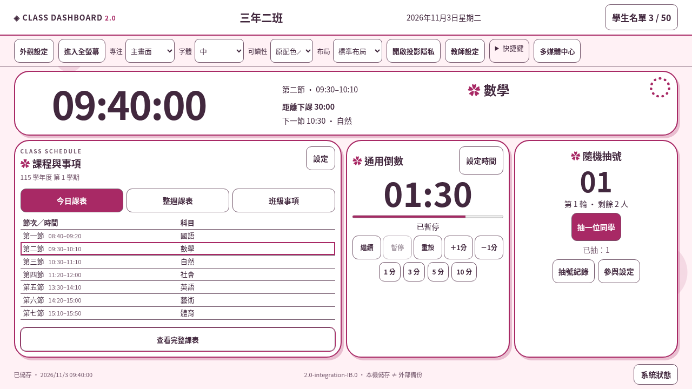
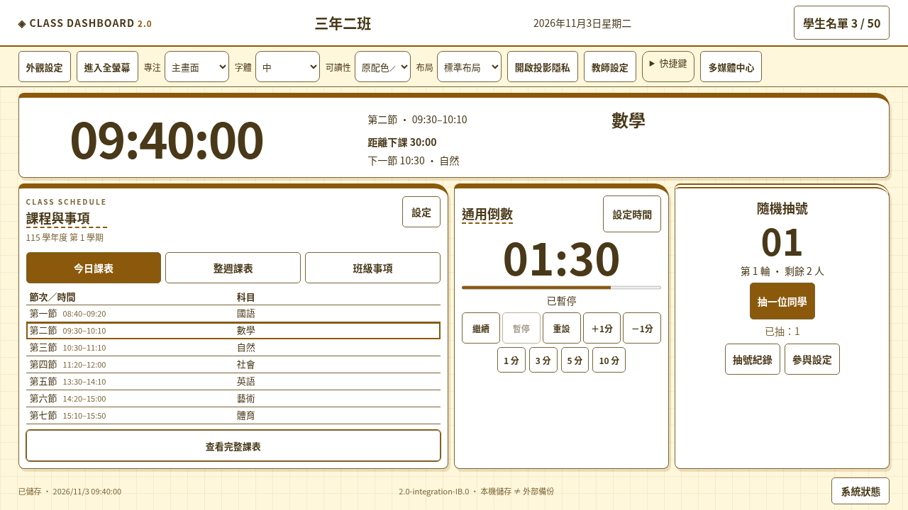
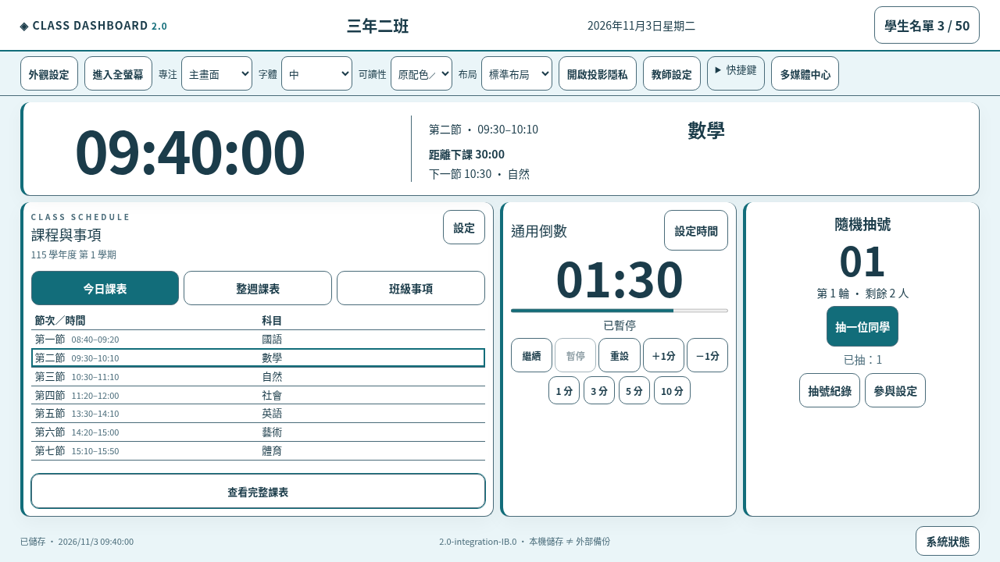
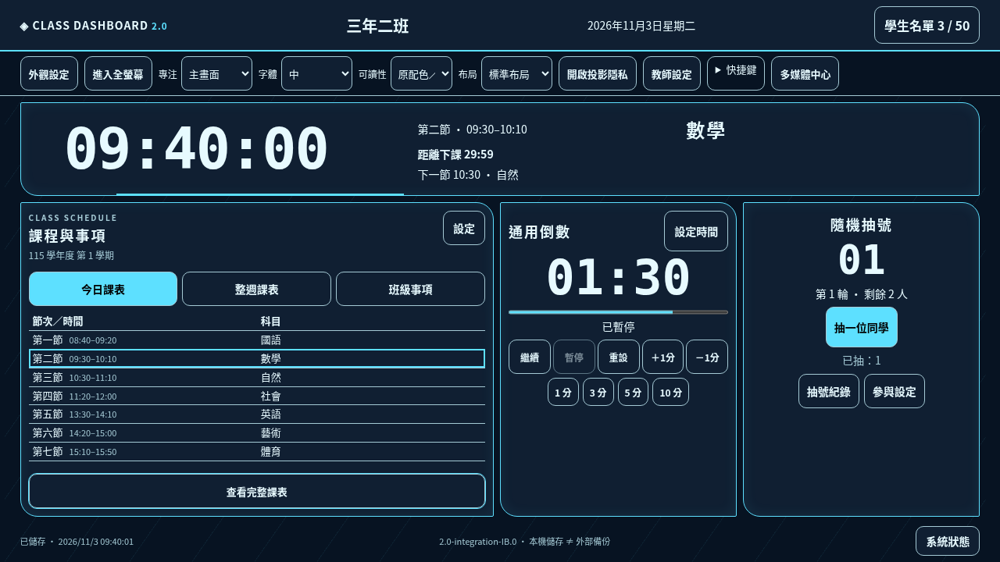
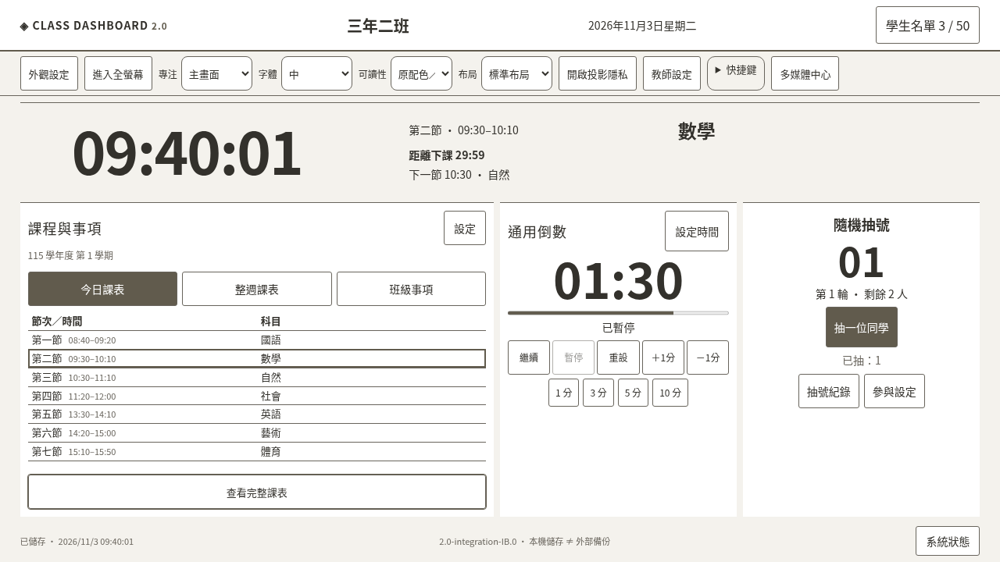
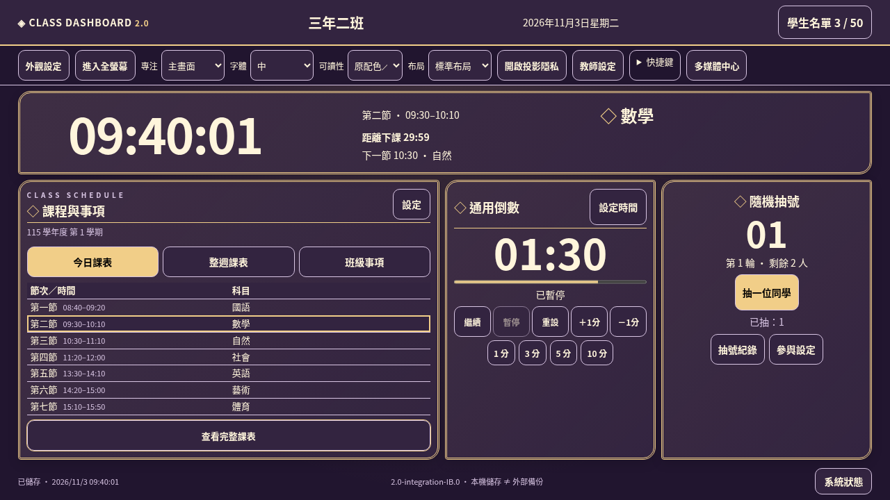

# I-B｜首頁、頁籤與外觀整合驗收

日期：2026-11-03（臺灣）。應用版本 `2.0-integration-IB.0`；資料 schema 7。基底 main `fb84a57`（已合併 4D PR #7），分支 `develop/class-dashboard-v2-integration-ib`。僅修改 `class-dashboard-v2/`；不合併 main、不更新正式站。

## 完成功能

1. 重新配置單屏首頁：精簡品牌／班級／日期工具列，集中的臺灣時鐘、目前節次／科目／課程時間、作息倒數與下一節；手動活動倒數獨立不變。保留既有四種專注、全螢幕、隱私、四級字體與三布局。
2. 課程與事項卡片具今日、整週、班級事項三頁籤。左右鍵／Home／End、觸控可切換，使用 aria-selected、aria-controls／tabpanel；切頁不重建 app、不改 timer／picker／媒體、不清教師表單草稿。
3. 事項顯示筆數／未完成數及前兩項摘要；「查看完整事項」保留所有文字及完成狀態。課表「查看完整」移用既有表格節點，關閉後回原位，沒有複製 ID 或第二套課表。大量節次可在卡片內或完整子畫面捲動。
4. 抽號卡片保留主操作、已抽摘要與剩餘人數；紀錄視窗只用座號顯示全部已抽及今日剩餘，參與設定仍走原隱私保護的教師設定。
5. 外觀設定提供六個具有結構差異的風格、各三套配色，預覽／確認／取消（含 Esc）；保存成功才套用已保存狀態，失敗回復原外觀及選項並提示。預覽本身不寫資料、不增加 revision。
6. 新外觀與既有主題／字體／布局／隱私／媒體 dialog 共用。深色配色可選明亮可讀版本；高對比統一覆蓋配色與裝飾。尊重 reduced-motion，不載入外部字型、付費素材或大型圖檔。
7. 背景音樂保留同一迷你控制列；長名稱使用可開啟查看的摘要。全螢幕詳情及重複系統訊息集中到狀態視窗，工具列仍呈現操作錯誤。原四分頁設定、CSV/XLSX 的驗證／預覽／確認、JSON 還原確認與媒體生命週期保留。

## 六風格／十八配色

| 風格 | 配色 | 結構差異 |
| --- | --- | --- |
| 低年級童趣 | 彩虹糖果、海洋冒險、森林樂園 | 圓潤積木框、花形標記與原創太陽裝飾 |
| 中年級活潑學習 | 陽光校園、薄荷創意、莓果活力 | 方格紙、文具標籤、粗上框／異角卡片 |
| 高年級清新資訊 | 天空青綠、奶油暖橘、鼠尾草綠 | 細分隔、側邊標記、規整資訊層級 |
| 青少年科技 | 霓虹電光、賽博紫夜、極光綠黑 | 切角幾何、等寬數字、節制掃描光 |
| 極簡專業 | 暖白灰階、冷白藍灰、深灰極簡 | 無陰影平面、無圓角、低裝飾細線 |
| 華麗展示 | 紫金星夜、皇家藍金、櫻花琉璃 | 雙層細框、琉璃漸層、菱形裝飾 |

「保留原有外觀」為相容預設，不計入六風格。保存只有白名單 style／palette ID；不接受備份內任意 CSS／HTML／外部素材網址。Tokens 包含背景、卡片、文字／次要文字、邊框、強調色、按鈕前景及錯誤／回饋色。一般／明亮／高對比模式下 18 配色的文字及按鈕對比由 Node 檢查 AA；高對比保留風格輪廓並移除影響可讀性的背景／動畫。

## 實際運行畫面

1280×720、合成資料、臺灣平日 09:40；每款使用第一套配色。這些是可執行網站的截圖證據，不是替代功能的示意設計；圖片只在文件載入，不加入首頁資源。

| 童趣 | 活潑學習 |
| --- | --- |
|  |  |
| 清新資訊 | 科技 |
|  |  |
| 極簡 | 華麗 |
|  |  |

## 單螢幕的驗收範圍與降級

不使用 body overflow:hidden 掩蓋內容。桌面透過可用高度的 Grid、縮減裝飾／間距、頁籤、事項／已抽／檔名摘要及完整視窗分配空間。重要按鈕保留；桌面課表可有內部捲動，完整課表可放大閱讀，沒有刪節次或截斷保存資料。

測試可用 viewport：1920×1080、1600×900、1366×768、1280×720、1024×768、1366×660、1280×620、1280×800。620／660px 低高度涵蓋瀏覽器工具列佔用後的內容區，不能把顯示器解析度直接當可用高度。

- 專屬測試以 100 則長事項、背景音樂控制列、操作訊息、一般科目／節次名稱執行，18 配色 × 8 尺寸 × 3 布局 × 4 字體，共 **1,728 組**，檢查頁面無水平／垂直捲軸、主畫面按鈕在可用範圍、計時／抽號卡片內容不超出卡片。
- 字體仍有四級；緊湊首頁使用數字／表格安全上限避免擠掉控制，較大兩級可能達到相同上限。原有專注與完整內容仍依原 scale 放大。不是把全站字體縮成難讀以通過。
- 窄於 960px、高低於 620px（包含手機及高倍率縮放後的 CSS viewport）採自然垂直閱讀布局，允許頁面捲動、保持按鈕可達，不宣稱這些條件無捲軸。
- 即使桌面尺寸，超長科目／節次名稱等重要文字若超出時間卡片，亦自動明示改為可捲動閱讀，不裁切。程式用單次 mount 的 MutationObserver 與既有更新／resize 檢查，不新增倒數計時核心。這是最大字串內容的明確降級，**不宣稱任意極端內容都能單屏**。
- 另以最多 50 人、49 人已抽、40 節次、長科目／節次驗證降級、全部節次與剩餘座號可在完整視窗閱讀，沒有姓名出現在公開紀錄視窗。

## 資料相容與核心重用

schema 6→7 僅加入 `appearance:{style:'legacy',palette:'default'}`。display 原欄位／值、學生固定 ID／姓名／座號、學期／作息／週課表／單日調課、聯絡簿、抽號、影音清單／偏好／連動及停用任務歷史保持原資料。舊遷移鏈保留；讀取不寫回，第一筆成功命令才保存 schema 7。

SET_APPEARANCE 使用原 store → 同名 Web Lock → 原始快照／過期保護 → 完整驗證 → 成功保存 → 更新。非法組合、Quota 與過期分頁不能提交。完整 JSON 仍用原 formatVersion 1（上限 8 MB）涵蓋全部資料；還原預覽顯示外觀名稱並保留明確確認，失敗不覆蓋。

`ui/overlay.js` 只協調原生 dialog，不新增媒體引擎，關閉原媒體仍由既有 close/cancel 處理影片停止與音樂背景播放。首頁頁籤／完整內容開啟及 appearance draft 為 runtime 狀態，不保存。沿用 `school/schedule`／timer／picker／media/coordinator；不恢復任務命令或水族箱。

schema 7 不能由舊 schema 6 程式編輯。更新前下載備份、關閉舊分頁；不要以清 localStorage 或降版本覆蓋修復。過期預覽仍會因其他已保存修改而拒絕，需重新預覽，不為方便取消保護。

## 自動化與實際結果

本次 Linux Chromium／Node 環境，使用根目錄的 Python HTTP server（8011）。於專案目錄執行：

```sh
npm run version:prepare
npm test
TEST_URL=http://127.0.0.1:8011/class-dashboard-v2/ npm run test:browser
node tools/check-deployment.mjs http://127.0.0.1:8011/class-dashboard-v2/
git diff --check
```

- Node：**79／79 通過**（原 74 項回歸＋5 項 I-B 模型／保存／遷移／對比測試）。歷史回歸調整為目前 schema 7 及 appearance 預設，仍逐欄保留舊 fixture 與非外觀業務紀錄；不是刪除失敗測試。
- 瀏覽器：第三階段、4A、4B、4C、4D 既有流程及 I-B 專屬流程通過。覆蓋學生／課表 CSV/XLSX、作息／調課、計時／抽號、聯絡簿、隱私／全螢幕／快捷鍵、影音原生解碼／互斥／資源釋放、JSON／Quota／過期頁與歷史保留。
- I-B：預覽／取消不寫入、成功保存／重載、Quota 回復；18 配色與 1,728 組版面矩陣；六種 computed 結構簽章不同；每套配色下四個既有專注模式可開啟／返回；高對比；三頁籤鍵盤；100 則事項完整閱讀；完整課表同一節點回位；未保存班級草稿不因頁籤切換丟失；同一音樂元素持續播放、timer.endAt 與 picker 不變；JSON 實際下載含 appearance；手機／極端內容可讀降級。
- 本機版本清單：54 個 HTML/CSS/JS。測試前更新雜湊，資源以專案相對路徑載入；不更動根目錄其他網站。

Node 日誌的 intentional renderer failure 是原有故障隔離測試刻意輸出，總結果無未解釋的失敗。外部媒體測試使用路由 fixture 配合真實 Chromium 解碼；YouTube iframe／API 是替身，不代表真實平台任意來源皆可播放。1,728 組矩陣的字體／布局透過既有控制項 change 事件驅動同一 store；另有真實 click／tap、鍵盤與原生播放流程。

## Windows 11 操作／人工驗收

1. 更新前從教師設定 → 資料管理下載完整 JSON；正式發布後關閉舊頁、Ctrl＋F5，確認頁尾 `2.0-integration-IB.0`、資料版本 7，舊資料仍在。本次未合併，正式站尚不會因此變成新介面。
2. 首頁切今日／整週／班級事項；左右鍵、Home／End 與觸控均可用。完整內容以按鈕開啟，關閉／Esc 回到原入口，長內容只在視窗內捲動。
3. 外觀設定選風格／配色看示意卡與背景預覽；按確認才保存。取消／Esc 應恢復，重新整理後保留保存外觀。可選保留原有外觀，不限制年級。
4. 切原配色／深海、明亮、高對比；調字體／布局，測四種原有專注與全螢幕。投影隱私仍需先明確關閉才能進教師設定／名單／匯入。
5. 倒數運行並播放背景音樂時切頁籤與外觀，應不中斷；抽號紀錄不應重設。媒體仍在原子畫面，關閉影片無背景聲。
6. 用實際瀏覽器工具列、Windows 縮放比例及白板測 16:9、16:10、4:3；正常範圍首頁無捲軸，手機／高縮放／超長名稱的閱讀降級要能捲到全部按鈕。不要只用全螢幕截圖代替一般視窗驗收。
7. 新版 JSON 下載／預覽／確認還原後，核對外觀、學生、課表、聯絡簿、抽號及影音。無效備份應拒絕；異常時保留原始副本，不刪瀏覽器資料。

Windows 11 Chrome／Edge、真實電子白板／投影／喇叭與第三方媒體本次未由此 Linux 環境直接驗證；需依上述人工步驟確認。

## 修改檔案

新增：`src/display/appearance.js`、`src/ui/appearance.js`、`src/ui/home.js`、`src/ui/overlay.js`、`styles/integration.css`、`styles/appearance.css`、`tests/integration-ib.test.js`、`tests/integration-ib-browser.cjs`、本紀錄與 `docs/screenshots/ib-*.png` 六款運行截圖。

功能調整：`index.html`、`src/app.js`、`src/core/{model,migrations,validation,store}.js`、`src/ui/{dom,display,media,tools,backup}.js`。新增外觀資料、頁籤／完整內容及原對話框協調；影音／倒數／抽號演算法未重寫。

驗證與版本：`package.json`、`tools/release.mjs`、`version.json`、`README.md`、既有 tests 的目前版本期望／外觀欄位比較。其他既有 JS diff 僅為統一 ES import 的版本參數，未啟用 legacy 功能。完整檔案清單於提交／PR 可核對。

## GitHub / Pages 與停止範圍

目前 main 的 4D 原始碼基準可由 Git 確認。公開 Pages 及 API 檢查受本環境 Forbidden／CONNECT 403 限制，不能宣稱已核對正式站即時部署或快取；本機相對資源檢查不能替代正式站驗證。實際提交、推送與 PR 結果由交付訊息列明，不捏造 PR 編號。

本批次只交付 I-B。沒有新增 I-C 的全卡片置中聚焦、三音效、試聽、次數及兩入口音效控制；原有提示音及專注保留。未開始 I-C、I-D 或第五階段，等待使用者驗收確認。
