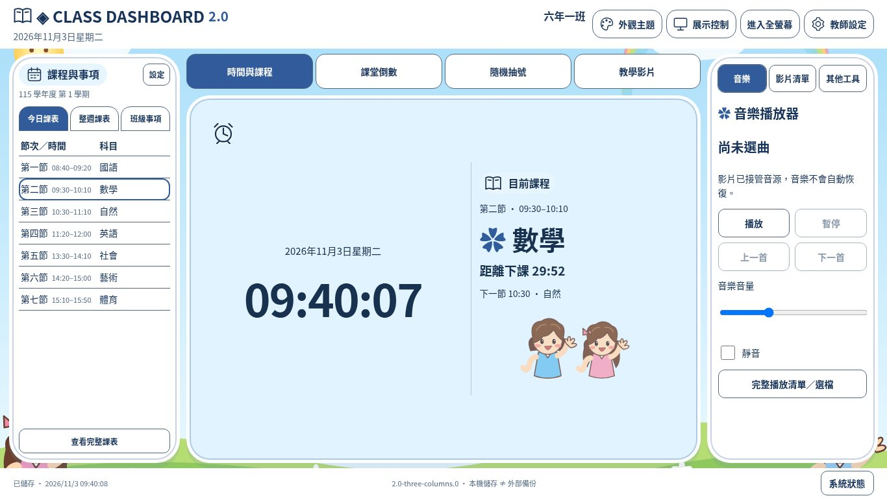
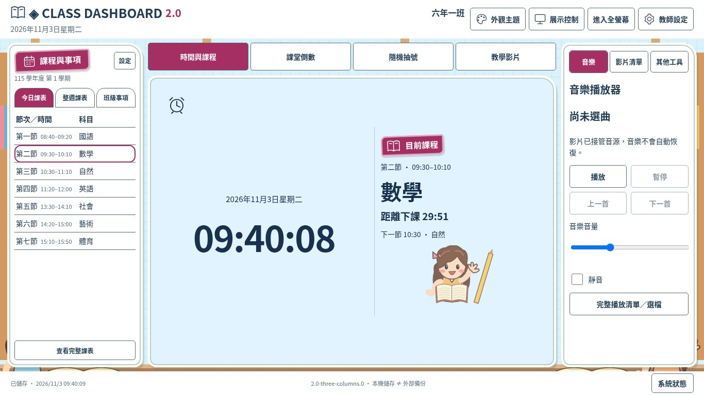
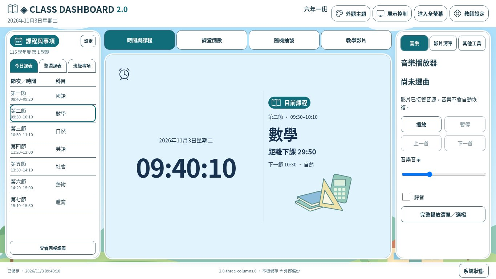
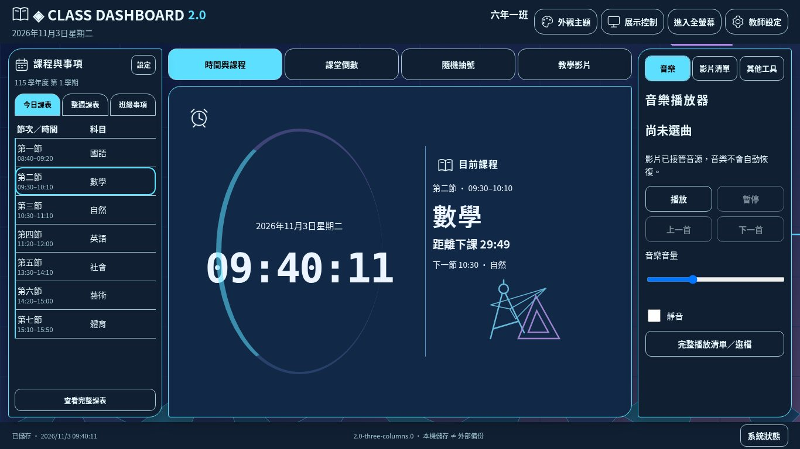
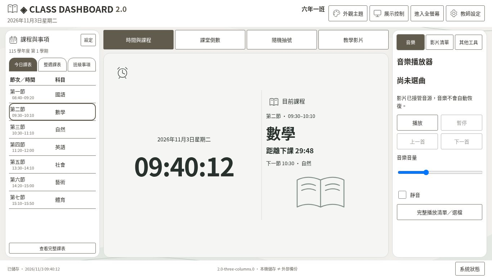
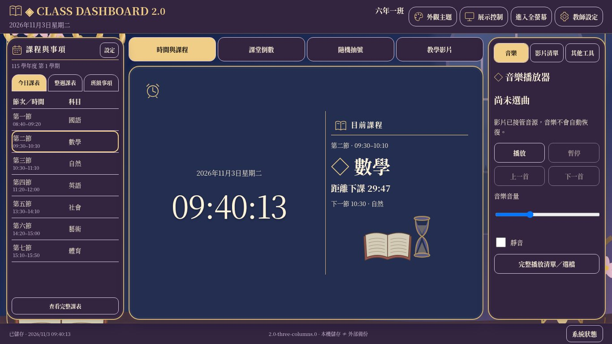

# 三欄首頁與多媒體整合｜開發自測報告

版本 **2.0-three-columns.0**，schemaVersion **7**，JSON formatVersion **1**。開發分支 `develop/class-dashboard-v2-three-columns`。

## 基準與範圍

Git確認 main＝737a5df、PR #10 head＝8e19b1c，後者不是 main 祖先，故未合併。本分支從PR #10最新程式開始，保留其歷史與成果；新PR以main為目標，包含PR #10尚未合併部分。API目前Forbidden，不能以API核實PR標題／檢查狀態，但Git ancestry可確認上述程式關係。沒有更動main、Pages來源、其他網站或關閉舊PR。

本次是布局／播放操作整合：不改學生、課表、聯絡簿、倒數、抽號或影音資料模型，不恢復任務與水族箱。資料驗證、Web Locks、過期分頁及完整JSON流程保留。

## 新舊差異

| 區域 | PR #10雙欄 | 三欄版 |
| --- | --- | --- |
| 左側 | 約30%，三頁籤 | 約20%，今日／整週／班級事項；窄週表精簡字級，完整視窗保留 |
| 中央 | 約70%，三頁籤；時鐘與課程兩區 | 約60%，四頁籤；時間與課程同一張卡片，寬時左右、窄時上下；加入中央影片 |
| 右側 | 無獨立工具欄 | 約20%，音樂／影片清單／其他工具獨立頁籤 |
| 工具入口 | 底部四工具列 | 移入右側其他工具，頂部不新增重複系統設定 |
| 影片 | 完整多媒體對話框 | 從初始化起固定中央，完整清單選片後交接中央，不搬移節點 |
| 關閉／切頁 | 舊影音視窗關閉影片停止 | 完整清單是管理視窗；中央影片切頁暫停，同一來源保留進度；停止／改播來源才清理 |

標準桌面比例以20:60:20為目標，窄螢幕保留側欄最小可讀寬；三個既有布局偏好可略調比例。一般桌面不裁切頁面；複雜清單／完整內容內部捲動。寬不足960或高不足620時改為可捲動閱讀，不以overflow:hidden遮住整頁問題。

## 實際截圖

108張Linux Chromium截圖：18配色×3尺寸的時間與課程，加6風格預設配色×3尺寸×3其他中央模式。影片使用本機測試WebM經HTTPS路由替身載入，是真實瀏覽器解碼，**不是外部平台實播**。班級／課表資料為合成資料。

[原始幾何與三欄寬度量測](three-columns-geometry.json)。以下每種風格提供三尺寸、四中央模式。

### A 低年級童趣

[PR #10原布局](screenshots/home-layout/playful-candy-clock-1366x768.jpg)

| 中央模式 | 1920×1080 | 1366×768 | 1024×768 |
| --- | --- | --- | --- |
| 時間與課程 | [實際截圖](screenshots/three-columns/playful-candy-clock-1920x1080.jpg) | [實際截圖](screenshots/three-columns/playful-candy-clock-1366x768.jpg) | [實際截圖](screenshots/three-columns/playful-candy-clock-1024x768.jpg) |
| 倒數 | [實際截圖](screenshots/three-columns/playful-candy-timer-1920x1080.jpg) | [實際截圖](screenshots/three-columns/playful-candy-timer-1366x768.jpg) | [實際截圖](screenshots/three-columns/playful-candy-timer-1024x768.jpg) |
| 抽號 | [實際截圖](screenshots/three-columns/playful-candy-picker-1920x1080.jpg) | [實際截圖](screenshots/three-columns/playful-candy-picker-1366x768.jpg) | [實際截圖](screenshots/three-columns/playful-candy-picker-1024x768.jpg) |
| 教學影片 | [實際截圖](screenshots/three-columns/playful-candy-video-1920x1080.jpg) | [實際截圖](screenshots/three-columns/playful-candy-video-1366x768.jpg) | [實際截圖](screenshots/three-columns/playful-candy-video-1024x768.jpg) |
### B 中年級活潑

[PR #10原布局](screenshots/home-layout/study-sun-clock-1366x768.jpg)

| 中央模式 | 1920×1080 | 1366×768 | 1024×768 |
| --- | --- | --- | --- |
| 時間與課程 | [實際截圖](screenshots/three-columns/study-sun-clock-1920x1080.jpg) | [實際截圖](screenshots/three-columns/study-sun-clock-1366x768.jpg) | [實際截圖](screenshots/three-columns/study-sun-clock-1024x768.jpg) |
| 倒數 | [實際截圖](screenshots/three-columns/study-sun-timer-1920x1080.jpg) | [實際截圖](screenshots/three-columns/study-sun-timer-1366x768.jpg) | [實際截圖](screenshots/three-columns/study-sun-timer-1024x768.jpg) |
| 抽號 | [實際截圖](screenshots/three-columns/study-sun-picker-1920x1080.jpg) | [實際截圖](screenshots/three-columns/study-sun-picker-1366x768.jpg) | [實際截圖](screenshots/three-columns/study-sun-picker-1024x768.jpg) |
| 教學影片 | [實際截圖](screenshots/three-columns/study-sun-video-1920x1080.jpg) | [實際截圖](screenshots/three-columns/study-sun-video-1366x768.jpg) | [實際截圖](screenshots/three-columns/study-sun-video-1024x768.jpg) |
### C 高年級清新

[PR #10原布局](screenshots/home-layout/fresh-sky-clock-1366x768.jpg)

| 中央模式 | 1920×1080 | 1366×768 | 1024×768 |
| --- | --- | --- | --- |
| 時間與課程 | [實際截圖](screenshots/three-columns/fresh-sky-clock-1920x1080.jpg) | [實際截圖](screenshots/three-columns/fresh-sky-clock-1366x768.jpg) | [實際截圖](screenshots/three-columns/fresh-sky-clock-1024x768.jpg) |
| 倒數 | [實際截圖](screenshots/three-columns/fresh-sky-timer-1920x1080.jpg) | [實際截圖](screenshots/three-columns/fresh-sky-timer-1366x768.jpg) | [實際截圖](screenshots/three-columns/fresh-sky-timer-1024x768.jpg) |
| 抽號 | [實際截圖](screenshots/three-columns/fresh-sky-picker-1920x1080.jpg) | [實際截圖](screenshots/three-columns/fresh-sky-picker-1366x768.jpg) | [實際截圖](screenshots/three-columns/fresh-sky-picker-1024x768.jpg) |
| 教學影片 | [實際截圖](screenshots/three-columns/fresh-sky-video-1920x1080.jpg) | [實際截圖](screenshots/three-columns/fresh-sky-video-1366x768.jpg) | [實際截圖](screenshots/three-columns/fresh-sky-video-1024x768.jpg) |
### D 青少年科技

[PR #10原布局](screenshots/home-layout/tech-electric-clock-1366x768.jpg)

| 中央模式 | 1920×1080 | 1366×768 | 1024×768 |
| --- | --- | --- | --- |
| 時間與課程 | [實際截圖](screenshots/three-columns/tech-electric-clock-1920x1080.jpg) | [實際截圖](screenshots/three-columns/tech-electric-clock-1366x768.jpg) | [實際截圖](screenshots/three-columns/tech-electric-clock-1024x768.jpg) |
| 倒數 | [實際截圖](screenshots/three-columns/tech-electric-timer-1920x1080.jpg) | [實際截圖](screenshots/three-columns/tech-electric-timer-1366x768.jpg) | [實際截圖](screenshots/three-columns/tech-electric-timer-1024x768.jpg) |
| 抽號 | [實際截圖](screenshots/three-columns/tech-electric-picker-1920x1080.jpg) | [實際截圖](screenshots/three-columns/tech-electric-picker-1366x768.jpg) | [實際截圖](screenshots/three-columns/tech-electric-picker-1024x768.jpg) |
| 教學影片 | [實際截圖](screenshots/three-columns/tech-electric-video-1920x1080.jpg) | [實際截圖](screenshots/three-columns/tech-electric-video-1366x768.jpg) | [實際截圖](screenshots/three-columns/tech-electric-video-1024x768.jpg) |
### E 極簡專業

[PR #10原布局](screenshots/home-layout/minimal-warm-clock-1366x768.jpg)

| 中央模式 | 1920×1080 | 1366×768 | 1024×768 |
| --- | --- | --- | --- |
| 時間與課程 | [實際截圖](screenshots/three-columns/minimal-warm-clock-1920x1080.jpg) | [實際截圖](screenshots/three-columns/minimal-warm-clock-1366x768.jpg) | [實際截圖](screenshots/three-columns/minimal-warm-clock-1024x768.jpg) |
| 倒數 | [實際截圖](screenshots/three-columns/minimal-warm-timer-1920x1080.jpg) | [實際截圖](screenshots/three-columns/minimal-warm-timer-1366x768.jpg) | [實際截圖](screenshots/three-columns/minimal-warm-timer-1024x768.jpg) |
| 抽號 | [實際截圖](screenshots/three-columns/minimal-warm-picker-1920x1080.jpg) | [實際截圖](screenshots/three-columns/minimal-warm-picker-1366x768.jpg) | [實際截圖](screenshots/three-columns/minimal-warm-picker-1024x768.jpg) |
| 教學影片 | [實際截圖](screenshots/three-columns/minimal-warm-video-1920x1080.jpg) | [實際截圖](screenshots/three-columns/minimal-warm-video-1366x768.jpg) | [實際截圖](screenshots/three-columns/minimal-warm-video-1024x768.jpg) |
### F 華麗展示

[PR #10原布局](screenshots/home-layout/elegant-royal-purple-clock-1366x768.jpg)

| 中央模式 | 1920×1080 | 1366×768 | 1024×768 |
| --- | --- | --- | --- |
| 時間與課程 | [實際截圖](screenshots/three-columns/elegant-royal-purple-clock-1920x1080.jpg) | [實際截圖](screenshots/three-columns/elegant-royal-purple-clock-1366x768.jpg) | [實際截圖](screenshots/three-columns/elegant-royal-purple-clock-1024x768.jpg) |
| 倒數 | [實際截圖](screenshots/three-columns/elegant-royal-purple-timer-1920x1080.jpg) | [實際截圖](screenshots/three-columns/elegant-royal-purple-timer-1366x768.jpg) | [實際截圖](screenshots/three-columns/elegant-royal-purple-timer-1024x768.jpg) |
| 抽號 | [實際截圖](screenshots/three-columns/elegant-royal-purple-picker-1920x1080.jpg) | [實際截圖](screenshots/three-columns/elegant-royal-purple-picker-1366x768.jpg) | [實際截圖](screenshots/three-columns/elegant-royal-purple-picker-1024x768.jpg) |
| 教學影片 | [實際截圖](screenshots/three-columns/elegant-royal-purple-video-1920x1080.jpg) | [實際截圖](screenshots/three-columns/elegant-royal-purple-video-1366x768.jpg) | [實際截圖](screenshots/three-columns/elegant-royal-purple-video-1024x768.jpg) |

## 18配色全覽

| 風格／配色 | 1920×1080 | 1366×768 | 1024×768 |
| --- | --- | --- | --- |
| playful/candy | [實際截圖](screenshots/three-columns/playful-candy-clock-1920x1080.jpg) | [實際截圖](screenshots/three-columns/playful-candy-clock-1366x768.jpg) | [實際截圖](screenshots/three-columns/playful-candy-clock-1024x768.jpg) |
| playful/ocean | [實際截圖](screenshots/three-columns/playful-ocean-clock-1920x1080.jpg) | [實際截圖](screenshots/three-columns/playful-ocean-clock-1366x768.jpg) | [實際截圖](screenshots/three-columns/playful-ocean-clock-1024x768.jpg) |
| playful/forest | [實際截圖](screenshots/three-columns/playful-forest-clock-1920x1080.jpg) | [實際截圖](screenshots/three-columns/playful-forest-clock-1366x768.jpg) | [實際截圖](screenshots/three-columns/playful-forest-clock-1024x768.jpg) |
| study/sun | [實際截圖](screenshots/three-columns/study-sun-clock-1920x1080.jpg) | [實際截圖](screenshots/three-columns/study-sun-clock-1366x768.jpg) | [實際截圖](screenshots/three-columns/study-sun-clock-1024x768.jpg) |
| study/mint | [實際截圖](screenshots/three-columns/study-mint-clock-1920x1080.jpg) | [實際截圖](screenshots/three-columns/study-mint-clock-1366x768.jpg) | [實際截圖](screenshots/three-columns/study-mint-clock-1024x768.jpg) |
| study/berry | [實際截圖](screenshots/three-columns/study-berry-clock-1920x1080.jpg) | [實際截圖](screenshots/three-columns/study-berry-clock-1366x768.jpg) | [實際截圖](screenshots/three-columns/study-berry-clock-1024x768.jpg) |
| fresh/sky | [實際截圖](screenshots/three-columns/fresh-sky-clock-1920x1080.jpg) | [實際截圖](screenshots/three-columns/fresh-sky-clock-1366x768.jpg) | [實際截圖](screenshots/three-columns/fresh-sky-clock-1024x768.jpg) |
| fresh/cream | [實際截圖](screenshots/three-columns/fresh-cream-clock-1920x1080.jpg) | [實際截圖](screenshots/three-columns/fresh-cream-clock-1366x768.jpg) | [實際截圖](screenshots/three-columns/fresh-cream-clock-1024x768.jpg) |
| fresh/sage | [實際截圖](screenshots/three-columns/fresh-sage-clock-1920x1080.jpg) | [實際截圖](screenshots/three-columns/fresh-sage-clock-1366x768.jpg) | [實際截圖](screenshots/three-columns/fresh-sage-clock-1024x768.jpg) |
| tech/electric | [實際截圖](screenshots/three-columns/tech-electric-clock-1920x1080.jpg) | [實際截圖](screenshots/three-columns/tech-electric-clock-1366x768.jpg) | [實際截圖](screenshots/three-columns/tech-electric-clock-1024x768.jpg) |
| tech/cyber | [實際截圖](screenshots/three-columns/tech-cyber-clock-1920x1080.jpg) | [實際截圖](screenshots/three-columns/tech-cyber-clock-1366x768.jpg) | [實際截圖](screenshots/three-columns/tech-cyber-clock-1024x768.jpg) |
| tech/aurora | [實際截圖](screenshots/three-columns/tech-aurora-clock-1920x1080.jpg) | [實際截圖](screenshots/three-columns/tech-aurora-clock-1366x768.jpg) | [實際截圖](screenshots/three-columns/tech-aurora-clock-1024x768.jpg) |
| minimal/warm | [實際截圖](screenshots/three-columns/minimal-warm-clock-1920x1080.jpg) | [實際截圖](screenshots/three-columns/minimal-warm-clock-1366x768.jpg) | [實際截圖](screenshots/three-columns/minimal-warm-clock-1024x768.jpg) |
| minimal/cool | [實際截圖](screenshots/three-columns/minimal-cool-clock-1920x1080.jpg) | [實際截圖](screenshots/three-columns/minimal-cool-clock-1366x768.jpg) | [實際截圖](screenshots/three-columns/minimal-cool-clock-1024x768.jpg) |
| minimal/graphite | [實際截圖](screenshots/three-columns/minimal-graphite-clock-1920x1080.jpg) | [實際截圖](screenshots/three-columns/minimal-graphite-clock-1366x768.jpg) | [實際截圖](screenshots/three-columns/minimal-graphite-clock-1024x768.jpg) |
| elegant/royal-purple | [實際截圖](screenshots/three-columns/elegant-royal-purple-clock-1920x1080.jpg) | [實際截圖](screenshots/three-columns/elegant-royal-purple-clock-1366x768.jpg) | [實際截圖](screenshots/three-columns/elegant-royal-purple-clock-1024x768.jpg) |
| elegant/royal-blue | [實際截圖](screenshots/three-columns/elegant-royal-blue-clock-1920x1080.jpg) | [實際截圖](screenshots/three-columns/elegant-royal-blue-clock-1366x768.jpg) | [實際截圖](screenshots/three-columns/elegant-royal-blue-clock-1024x768.jpg) |
| elegant/sakura | [實際截圖](screenshots/three-columns/elegant-sakura-clock-1920x1080.jpg) | [實際截圖](screenshots/three-columns/elegant-sakura-clock-1366x768.jpg) | [實際截圖](screenshots/three-columns/elegant-sakura-clock-1024x768.jpg) |

## 播放核心與生命周期

- 唯一coordinator／audio／video／YouTube adapter；初始化HTML即把video與iframe host放中央。沒有播放中reparent、克隆或第二套播放狀態。右側使用同一引擎訂閱與命令；偏好仍經原store／驗證保存。
- 原生影片跨中央頁籤：pause而非stop，src、節點、currentTime保留；回來可播放。放大用同一節點的原生dialog top layer，Fullscreen API作用於影片容器，不對不允許fullscreen的dialog本身呼叫。
- YouTube在API就緒時pauseVideo，保留同一iframe。恢復使用官方播放器，新增adapter.play可支援原協調核心恢復而不重掛載。禁止嵌入／API未就緒時若不能可靠暫停，沿用安全停止與提示；這種情況無法保證進度，不能聲稱所有YouTube皆可保留。
- 中央原生影片使用瀏覽器合法的進度、音量、播放控制；YouTube不啟用假冒原生控制，使用官方介面。YouTube實際狀態由平台控制，不把已送出暫停指令當成持續可觀察的實際狀態。
- 完整多媒體現在是清單／選檔視窗，關閉它不清掉中央來源；在中央按停止／改播另一來源會沿用原引擎清理舊來源。切頁與切換來源是不同操作，後者不承諾保留上一個來源的進度。
- 影片選擇由新selected事件交接中央；從專注模式選片時先經原store保存返回主畫面，成功後才播放，避免影片在隱藏展示區發聲。音樂影片互斥，不自動恢復舊音樂。
- 本機URL保留在本次暫存佇列，清空／dispose釋放；不寫入localStorage或JSON。播放器錯誤可見於中央與右側，不修改課表、學生或計時狀態。
- 原計時影音連動模組不改，已測音樂開始／暫停、影片在計時結束暫停。四專注、投影隱私、原全螢幕及JSON仍保留。main沒有I-C新增卡片聚焦／新音效試聽，本次不冒稱補完；影片專屬放大已實作。
- 非模態影片dialog只在放大時變為模態；全站遮罩與快捷鍵改用:modal判定，避免常駐影片容器阻擋快捷鍵或被其他視窗意外關閉。

## 開發驗證

[指令結果摘要](three-columns-test-results.txt)。測試使用HTTP服務repository根目錄，TEST_URL指向/class-dashboard-v2/。本次localhost:8012；需Playwright及Chromium，日常教師不用命令列。

| 項目 | 方法 | 實際結果 | 狀態 | 嚴重度／建議 |
| --- | --- | --- | --- | --- |
| 核心、資料與版本 | npm test | 84項，0失敗；新增原生暫停／恢復不重載及YouTube不重掛載測試 | 通過 | schema7與JSON格式不變 |
| 三欄與中央四頁籤 | three-columns-browser | 18配色×5尺寸×4模式＝360組；標準三欄比例偏差小於4百分點，無頁面／按鈕／卡片溢出 | 通過 | 1920、1600、1366、1280、1024寬等指定尺寸 |
| 字級／布局／左側與右側 | 同上與media腳本 | 192字級案例；三布局比例有實際差異；三區頁籤獨立；左側完整／編輯保留 | 通過 | 18配色均套用測試 |
| 倒數／抽號／隱私 | 真實UI流程 | 跨頁籤deadline與提示保留、暫停繼續、抽號不重置、學生入口隱私停用 | 通過 | 沒有新權威資料 |
| 右側音樂 | 真實WAV／MP3與UI | 播放暫停、上一首下一首、音量靜音保存、背景播放、同一audio | 通過 | 實際喇叭未驗證 |
| 影片清單到中央 | 分類／搜尋／選擇；本機WebM | 原生直接與本機影片可中央播放；從專注及完整清單交接正確 | 通過 | HTTPS來源使用路由替身 |
| 切頁保留進度／放大／全螢幕 | 真實原生解碼、currentTime／src／節點檢查 | 暫停後位置穩定，恢復同一節點；Esc／還原／fullscreen不搬動 | 通過 | 非Windows實機 |
| 官方YouTube流程 | API／iframe路由替身 | 同一iframe跨頁及放大、pause指令、150錯誤提示、停止清理 | 模擬通過 | 外部平台實播未驗證 |
| 互斥／計時影音連動 | 真實播放器狀態 | 改播影片暫停音樂；改播音樂停止影片；timer開始／暫停音樂、結束暫停影片 | 通過 | 不自動恢復舊音樂 |
| JSON與資料 | 下載／無效拒絕／預覽確認還原 | 原學生ID、課表、事項、歷史完整；無效資料不覆蓋 | 通過 | Web Locks／過期頁核心測試仍執行 |
| 截圖與路徑 | capture:three／本機manifest | 108張、頁面錯誤0、幾何失敗0；73項資源路徑／SHA-256 | 通過 | 不是已發布證據 |
| 正式站／GitHub API | HTTP／API | API Forbidden，不能核實Pages部署或自動PR | 未驗證／受阻 | Git推送結果另報，不宣稱已建立PR |
| Windows11 Chrome／Edge／白板／喇叭／外部影音 | 缺少對應實機／來源存取 | 不宣稱通過 | 未驗證 | 依下列步驟驗收 |

開發中修正：dialog不能直接requestFullscreen（改影片容器）、非模態dialog誤擋快捷鍵、影片交接後原清單關閉會誤停止、測試close事件監聽註冊競態。修正後重新測試。環境中斷後已確認分支與修改保留，重新執行而非沿用中斷測試當最終結果。

舊Stage3～4D／卡片／雙欄UI腳本保留於歷史提交，現在test:browser執行三欄與影音兩支腳本，不宣稱舊UI腳本在新DOM也全部重跑通過。全部核心Node測試仍執行；這是開發自測，不是獨立ChatGPT整合驗收或上線核准。

## 修改檔案

- index.html、styles/three-columns.css：三欄、單張時間課程卡、四中央／三右側頁籤、固定影片host與原生dialog；沿用原視覺素材。
- src/ui/widgets.js、src/ui/stage.js、src/app.js：右側控制與清單、影片專屬放大、中央交接與切頁暫停，暫時UI狀態不增加持久欄位。
- src/ui/media.js：回傳同一引擎的UI facade、完整清單交接、可見錯誤、專注返回主畫面後播放。
- src/media/coordinator.js、src/media/youtube.js：selected事件與同一YouTube恢復控制；沒有第二套播放器。
- src/ui/overlay.js、src/ui/display.js：只將真正模態視窗視為遮罩與快捷鍵阻擋。
- tests/media.test.js、tests/three-columns-browser.cjs、tests/three-media-browser.cjs、tests/browser-helpers.cjs、tests/version.test.js：回歸及可靠close事件等待。
- tools/capture-three-columns.cjs、tools/release.mjs、package.json、version.json、README、Windows11／Pages指南、本報告、量測JSON、108張截圖。其餘ES module多為快取版本查詢字串同步，不改資料reducer。

## Windows11人工驗收

先完整JSON備份；三尺寸逐一套18配色。左側切三頁、完整與編輯；中央切四頁並跑倒數、抽號。右側選本機音樂／前後曲／音量靜音；選預存及本機影片中央播放，拖原生進度、調音量、切頁確認暫停，再回來繼續。放大Esc／還原及全螢幕均不重載；改播音樂確認影片停止，停止影片不自動恢復音樂。試合法YouTube（允許嵌入與禁止嵌入）、網路失敗提示及計時影音連動。最後測投影隱私、四專注、JSON預覽還原。

[完整操作指南](windows11-guide.md)。特殊小視窗／高縮放以可讀捲動降級；長清單內部捲動。第三方影片政策、實際聲音、觸控及Windows字型差異仍需實機確認。

## 交付狀態

PR以main為目標，但原始碼由尚未合併的PR #10最新提交延伸，包含其成果；未修改或關閉PR #10。未合併main、未修改Pages來源或更新正式站。Git提交、推送及PR建立結果見交付訊息；API受阻時只提供建立入口，不假稱PR完成。
