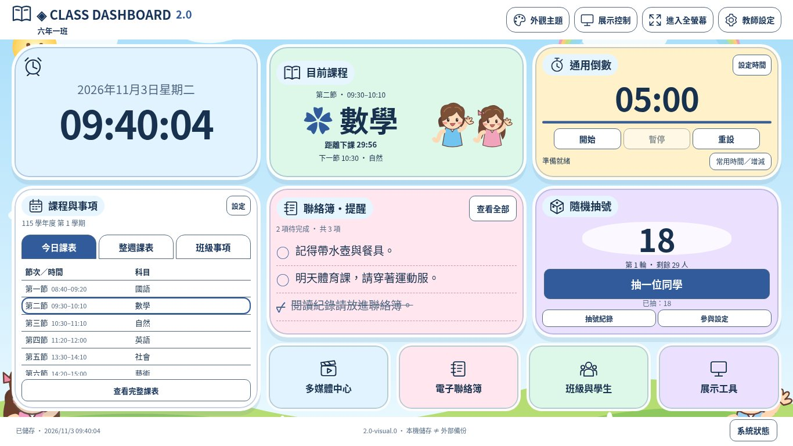
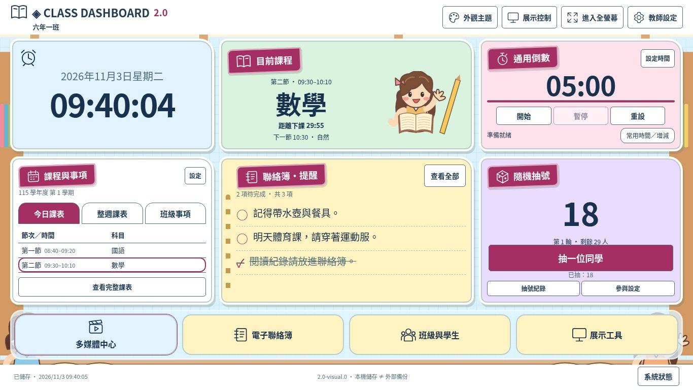
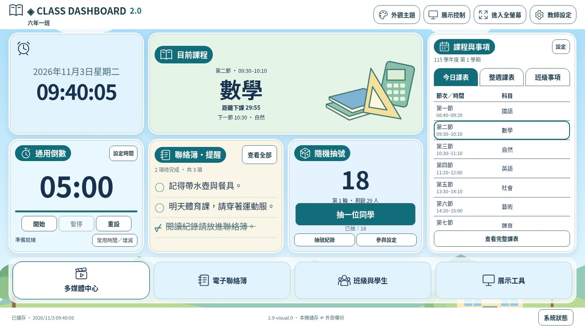
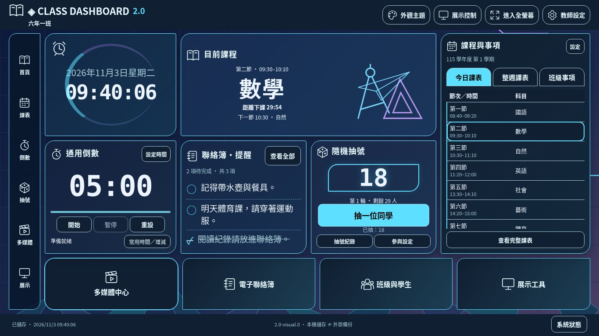
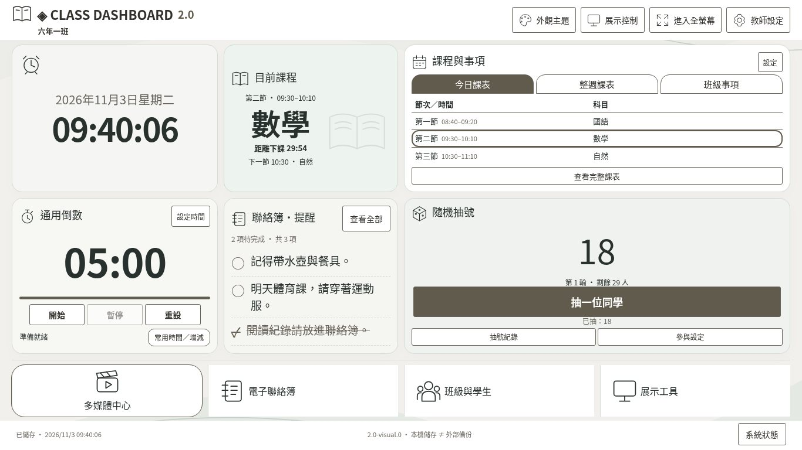
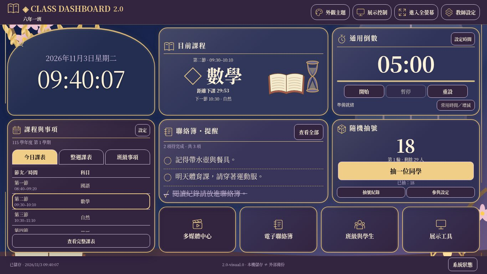

# 六風格視覺改善｜開發自測及審查資料

版本 **2.0-visual.0**，schemaVersion **7**。基準 main：`ac8beb6`；分支 `develop/class-dashboard-v2-visual-restoration`。本文件是開發自測，並非獨立 ChatGPT 整合驗收或使用者上線核准。

## 參考圖與差異分析

依本次六張圖片標題確認 A～F，最新指示要求一次交付六風格、18 配色，取代先 A 後確認流程。參考圖僅於對話中可見，Windows D: 原檔未掛載到雲端；因此以下是人工視覺對照，**沒有宣稱原圖像素差異計算**。原始完整圖片沒有放進網站背景。

原版是相同卡片與大量空白；本版拆出目前課程卡、加入同源事項摘要，採六個不同 CSS Grid 構圖、專屬場景／圖示／裝飾及卡片造型。細節與素材規範見 [設計計畫](visual-restoration-plan.md)。截圖使用明示的合成班級／課表測試資料，不含真實學生姓名，不代表正式站現況。

## A：低年級童趣

| 參考圖構圖及本版對應 | 保留差異／限制 |
| --- | --- |
| 粉彩雲朵／草地／彩虹，圓潤貼紙框；三個上方資訊卡與左側直向課表。 | 原創向量人物與場景，不是參考圖的手繪質感；保留真實七節課與完整控制。 |

| 配色 | 1920×1080 | 1366×768 | 1024×768 |
| --- | --- | --- | --- |
| 彩虹糖果 | [實際截圖](screenshots/visual/playful-candy-1920x1080.jpg) | [實際截圖](screenshots/visual/playful-candy-1366x768.jpg) | [實際截圖](screenshots/visual/playful-candy-1024x768.jpg) |
| 海洋冒險 | [實際截圖](screenshots/visual/playful-ocean-1920x1080.jpg) | [實際截圖](screenshots/visual/playful-ocean-1366x768.jpg) | [實際截圖](screenshots/visual/playful-ocean-1024x768.jpg) |
| 森林樂園 | [實際截圖](screenshots/visual/playful-forest-1920x1080.jpg) | [實際截圖](screenshots/visual/playful-forest-1366x768.jpg) | [實際截圖](screenshots/visual/playful-forest-1024x768.jpg) |
## B：中年級活潑學習

| 參考圖構圖及本版對應 | 保留差異／限制 |
| --- | --- |
| 教室窗景、方格紙、書櫃與文具；標籤式標題、筆記虛線；底部整列入口。 | 沒有加入參考圖的分組、噪音偵測、加分表等未開發工具。 |

| 配色 | 1920×1080 | 1366×768 | 1024×768 |
| --- | --- | --- | --- |
| 陽光校園 | [實際截圖](screenshots/visual/study-sun-1920x1080.jpg) | [實際截圖](screenshots/visual/study-sun-1366x768.jpg) | [實際截圖](screenshots/visual/study-sun-1024x768.jpg) |
| 薄荷創意 | [實際截圖](screenshots/visual/study-mint-1920x1080.jpg) | [實際截圖](screenshots/visual/study-mint-1366x768.jpg) | [實際截圖](screenshots/visual/study-mint-1024x768.jpg) |
| 莓果活力 | [實際截圖](screenshots/visual/study-berry-1920x1080.jpg) | [實際截圖](screenshots/visual/study-berry-1366x768.jpg) | [實際截圖](screenshots/visual/study-berry-1024x768.jpg) |
## C：高年級清新資訊

| 參考圖構圖及本版對應 | 保留差異／限制 |
| --- | --- |
| 校園山丘背景；右側長課表，左側時鐘、中間寬課程，第二列計時／事項／抽號。 | 未加入教材單元、班級廣播或學習統計；只呈現現有權威資料。 |

| 配色 | 1920×1080 | 1366×768 | 1024×768 |
| --- | --- | --- | --- |
| 天空青綠 | [實際截圖](screenshots/visual/fresh-sky-1920x1080.jpg) | [實際截圖](screenshots/visual/fresh-sky-1366x768.jpg) | [實際截圖](screenshots/visual/fresh-sky-1024x768.jpg) |
| 奶油暖橘 | [實際截圖](screenshots/visual/fresh-cream-1920x1080.jpg) | [實際截圖](screenshots/visual/fresh-cream-1366x768.jpg) | [實際截圖](screenshots/visual/fresh-cream-1024x768.jpg) |
| 鼠尾草綠 | [實際截圖](screenshots/visual/fresh-sage-1920x1080.jpg) | [實際截圖](screenshots/visual/fresh-sage-1366x768.jpg) | [實際截圖](screenshots/visual/fresh-sage-1024x768.jpg) |
## D：青少年科技

| 參考圖構圖及本版對應 | 保留差異／限制 |
| --- | --- |
| 左側實際快捷導航、儀表環時鐘、幾何文具、電路及低多邊形場景；右側高課表。 | 不是參考圖所有工具皆已開發；沒有跑馬燈、計分板或電子白板假入口。 |

| 配色 | 1920×1080 | 1366×768 | 1024×768 |
| --- | --- | --- | --- |
| 霓虹電光 | [實際截圖](screenshots/visual/tech-electric-1920x1080.jpg) | [實際截圖](screenshots/visual/tech-electric-1366x768.jpg) | [實際截圖](screenshots/visual/tech-electric-1024x768.jpg) |
| 賽博紫夜 | [實際截圖](screenshots/visual/tech-cyber-1920x1080.jpg) | [實際截圖](screenshots/visual/tech-cyber-1366x768.jpg) | [實際截圖](screenshots/visual/tech-cyber-1024x768.jpg) |
| 極光綠黑 | [實際截圖](screenshots/visual/tech-aurora-1920x1080.jpg) | [實際截圖](screenshots/visual/tech-aurora-1366x768.jpg) | [實際截圖](screenshots/visual/tech-aurora-1024x768.jpg) |
## E：極簡專業

| 參考圖構圖及本版對應 | 保留差異／限制 |
| --- | --- |
| 低裝飾、細線圖示、輕陰影、四欄資訊；較寬抽號區與底部簡潔入口。 | 整週課表沿用頁籤，沒有重複建立獨立課表資料；未加入螢幕亮度控制。 |

| 配色 | 1920×1080 | 1366×768 | 1024×768 |
| --- | --- | --- | --- |
| 暖白灰階 | [實際截圖](screenshots/visual/minimal-warm-1920x1080.jpg) | [實際截圖](screenshots/visual/minimal-warm-1366x768.jpg) | [實際截圖](screenshots/visual/minimal-warm-1024x768.jpg) |
| 冷白藍灰 | [實際截圖](screenshots/visual/minimal-cool-1920x1080.jpg) | [實際截圖](screenshots/visual/minimal-cool-1366x768.jpg) | [實際截圖](screenshots/visual/minimal-cool-1024x768.jpg) |
| 深灰極簡 | [實際截圖](screenshots/visual/minimal-graphite-1920x1080.jpg) | [實際截圖](screenshots/visual/minimal-graphite-1366x768.jpg) | [實際截圖](screenshots/visual/minimal-graphite-1024x768.jpg) |
## F：華麗展示

| 參考圖構圖及本版對應 | 保留差異／限制 |
| --- | --- |
| 拱形時鐘、金色框線、襯線標題、紫色層次、窗景／花葉／書本／燈籠原創裝飾。 | 輕量 SVG 不能等同參考圖繪畫級材質與光影；不加入畫面凍結、黑屏、白板等不存在的控制。 |

| 配色 | 1920×1080 | 1366×768 | 1024×768 |
| --- | --- | --- | --- |
| 紫金星夜 | [實際截圖](screenshots/visual/elegant-royal-purple-1920x1080.jpg) | [實際截圖](screenshots/visual/elegant-royal-purple-1366x768.jpg) | [實際截圖](screenshots/visual/elegant-royal-purple-1024x768.jpg) |
| 皇家藍金 | [實際截圖](screenshots/visual/elegant-royal-blue-1920x1080.jpg) | [實際截圖](screenshots/visual/elegant-royal-blue-1366x768.jpg) | [實際截圖](screenshots/visual/elegant-royal-blue-1024x768.jpg) |
| 櫻花琉璃 | [實際截圖](screenshots/visual/elegant-sakura-1920x1080.jpg) | [實際截圖](screenshots/visual/elegant-sakura-1366x768.jpg) | [實際截圖](screenshots/visual/elegant-sakura-1024x768.jpg) |

[完整指令結果摘要](visual-test-results.txt)

## 開發測試

可重跑：在專案根目錄以 HTTP 服務網站，設定 `TEST_URL` 為對應的 `/class-dashboard-v2/`，執行 `npm test`、`npm run test:browser`、`npm run capture:visual`。預設測試服務是 localhost:8000；本次使用 localhost:8011。瀏覽器腳本使用 Playwright 與 Chromium（可由 CHROMIUM_PATH 指定）。

| 測試項目 | 方法 | 預期／實際結果 | 狀態 | 嚴重度／建議 |
| --- | --- | --- | --- | --- |
| 資料及單元回歸 | Node 自動測試 | 82 項通過，含舊版遷移、ID／歷史、寫入失敗、過期分頁、備份、URL 及外觀驗證 | 通過 | 無新增資料結構 |
| 原有功能回歸 | Stage3、4A、4B、4C、4D Chromium 腳本 | 名單及課表 CSV/XLSX、作息、調課、計時／抽號／聯絡簿、備份、展示與媒體模擬流程 | 通過 | 不等同所有外部平台實播 |
| 版面矩陣 | I-B Chromium 腳本 | 18 配色 × 8 尺寸 × 3 布局 × 4 字級，共 1728 組；播放背景音樂與長事項同時存在 | 通過 | 保留超長內容可讀降級 |
| 18 外觀操作 | visual-browser | 實際套用、頁籤、完整事項、抽號／紀錄、隱私、展示控制、音樂不中斷及影片互斥 | 通過 | 共用原核心 |
| 三尺寸截圖 | capture:visual 真實 Chromium | 54 張；無執行錯誤、頁面溢出、卡片溢出或離屏按鈕；原始測量見 visual-geometry.json | 通過 | 截圖不是 Windows 實機 |
| 明亮／原配色／高對比 | runtime 與單元對比測試 | 18 配色下角色文字檢查；高對比移除場景並優先黑白 | 通過 | 實際投影仍需人工確認 |
| 正式站部署 | GitHub API／公開站 | 環境存取受限，未能獨立讀取正式站提交 | 未驗證 | 未部署；合併前由使用者核實 |
| Windows11 Chrome／Edge、觸控白板、喇叭 | 不具備此實機 | 尚無實機結果 | 未驗證 | 依下列步驟驗收 |
| 第三方 YouTube／遠端影音政策 | 官方 URL 解析及隔離模擬 | 不代表任意外部影片皆可播放 | 未驗證實播 | 需網路／合法來源實際測試 |

過程實際修正：舊 CSS 蓋掉角色卡片配色、計時文字換行、深淺主題標題對比、午休等長狀態文字、緊湊尺寸計時／抽號溢出及原生 dialog 關閉時焦點返回競態。修正後重新測試並產生截圖。沒有以 overflow:hidden 遮掉整頁問題。

## 資料相容性

沿用 schemaVersion 7：外觀 ID／配色 ID 不變，沒有新持久欄位或重設。學生 ID、作息、學期與課表、單日調課、聯絡簿、抽號、媒體庫、偏好及停用任務歷史仍由原 store／驗證／Web Locks 管理。JSON 格式未改。核心模組的多數 diff 僅為 release 更新 ES module 的快取版本查詢字串。

卡片摘要訂閱現有 store，只更新 DOM。新的展示控制 dialog 移動原控制，沒有建立第二個計時器、抽號器或播放器；完整課表及事項沿用既有內容對話框。原有四種專注模式保留；**main 未有 I-C 新卡片聚焦及新提示音種類／試聽，本次沒有將缺項冒稱已完成**。不能將本次結果視為全部 I-A～I-C 已驗收。

## 修改檔案範圍

- `index.html`：首頁結構、獨立課程卡、事項摘要、既有控制重新分組及實際快捷入口。
- `styles/visual.css`、`assets/visual/*`：六套構圖、十八配色整合、原創 SVG 與 CC0 聲明。
- `src/ui/visual.js`、`src/ui/home.js`、`src/ui/schedule.js`、`src/ui/dom.js`、`src/app.js`：單次掛載、同源摘要、對話框通知及可讀降級。
- `src/display/appearance.js`：風格說明及兩套預設配色可讀性改善，保存格式不變。
- `tests/*browser.cjs`、`tests/browser-helpers.cjs`：原操作入口重新分組後的真實 UI 測試；`tests/visual.test.js`、`tests/visual-browser.cjs` 新增素材及外觀回歸。
- `tools/release.mjs`、`tools/capture-visual.cjs`、`version.json`、`package.json`、`tests/version.test.js`：版本清單、截圖及測試指令。
- README、Windows11／Pages 文件、本計畫與報告、54 張截圖及測量 JSON。全部位於指定專案目錄。

13 個原創 SVG 合計不到 80 KB，沒有遠端美術服務；54 張審查 JPEG 不載入首頁。裝飾不攔截按鈕、不含真實文字內容；頁面文字可選取、課表與數字可更新。尊重 reduced-motion；高對比移除裝飾。

## Windows11 人工驗收

1. 先下載完整 JSON 備份，在 Chrome／Edge 以待審查版本測試；不要刪除瀏覽器資料。
2. 在三種指定視窗可用尺寸，逐一套用六風格三配色，檢查字體／按鈕、課表高亮及場景；與本次六張參考圖比較。
3. 開始 5 分鐘計時並播放自選本機音樂，切換外觀／今日及整週／事項、開關對話框，確認倒數與音樂不重設；影片切入與關閉測停止。
4. 抽號並重新整理、看抽號紀錄；開啟投影隱私確認學生管理無法意外開啟。
5. 試大字／高對比／全螢幕及 Esc。測完整事項、媒體、教師設定及匯入預覽的內部捲動；極小視窗允許可讀降級。
6. 匯出／預覽／確認還原 JSON，核對原學生、課表、事項、影音及歷史保留；測試喇叭與外部 YouTube 的來源限制。

## 審查及發布狀態

本次只開發視覺整合；沒有修改 main、Pages 設定或正式站。GitHub API 目前回覆 Forbidden，無法列出現有 PR 或讀取 Pages 設定；Git 推送與 PR 建立嘗試結果見交付訊息。使用者啟動獨立 ChatGPT 檢查後，才能產生獨立整合測試報告；本文件不代替該流程。正式上線決策由使用者作出。
